# Vibeweaver

[](https://github.com/logandoo/vibeweaver/actions/workflows/verify.yml)

Vibeweaver doesn't make a model stronger; it makes the ability already there actually count.

## Quickstart

```bash
git clone https://github.com/logandoo/vibeweaver
bash vibeweaver/vibeweaver/install.sh   # idempotent; safe to re-run
```

Restart opencode and ask for the work; the skill triggers on implement /
modify / debug / deploy coding tasks (not on Q&A or pure consulting).
Saying "strictly follow vibeweaver" at the start of the request makes triggering
essentially certain. For the plugins, the optional extras, and the Windows path,
see [Install](#install).

## Verify this release (w18.2)

Tags are immutable. From a clone at the tag:

```bash
python3 scripts/verify_release.py --root .   # MANIFEST OK N/N
sha256sum -c release/MANIFEST.sha256         # corruption only, not replacement
gh attestation verify release/MANIFEST.json --owner logandoo
```

`release/MANIFEST.json` binds every payload file by SHA-256 and
`vibeweaver/install.sh` verifies it before copying. Effect claims stay
`unverified`/`directional` until the preregistered G3 evaluation lands; no
single-run headline is published as a reliability claim.

## Why it exists

Give the human brain free rein and it runs on cognitive bias and
after-the-fact rationalization. Science is the countermeasure we built for it:
preregistration, blind review, lab notebooks, reproducibility. An LLM is the
same kind of machine — brilliant at pattern completion, and just as good at
making up its reasoning after the fact.

Vibeweaver puts coding work under the same discipline:

- Acceptance criteria are written before any action and cannot be relaxed
  mid-loop — preregistration.
- Reviewers and fresh-context verifiers judge the diff and the evidence, never
  the implementation's reasoning — blind review.
- Every hypothesis, diagnosis and falsification lands in an on-disk ledger,
  distilled into memory at task end — the lab notebook.
- Missing evidence blocks delivery mechanically — the publication gate.

None of this ages with model capability. The discipline stays no matter how
strong the model gets — even the smartest person still reaches for pen and
paper when the reasoning has to hold up.

A coding agent should be able to bring this discipline on its own, but opencode
and Codex don't ship it as a default: they hand you hooks and permissions, and
leave the policy to skills and plugins.

Coding agents fail on real projects in familiar ways: they delete files, refactor
code nobody asked them to touch, or break feature B while implementing feature A.
Most of these are process failures, not capability failures: the agent doesn't know
what "done" means, so it declares victory without proof. It skips the verification
it could have run. It forgets what the previous session learned, and drifts over
long tasks.

A stronger model doesn't fully fix this, and a longer prompt doesn't either: at
this point, LLM output is still probabilistic, and drift is nearly unavoidable.
Most SOTA models already know the right method; they still have lapses. That is
what Vibeweaver is for: when the output drifts, stop the model; when the approach
is wrong, make it start over. With the context kept in order and negative verdicts
from an external judge, the model usually knows how to correct itself. The skill
fixes two things at once:

- **The process**: decompose the request, search for prior art, choose between at
  least two approaches, design before code, test first, verify against runtime
  evidence, review before shipping.
- **The standard**: what counts as evidence, who grades it, and what happens when
  it is missing.

It adds no capability; it removes the ways capability gets wasted. It has a floor,
though: the model has to be able to remember the injected rules. The benchmarks
below show both directions: the weakest model in the set loses ground under the
full skill (it can't follow the process, and the context flood makes things worse),
while a capable model turns its existing ability into a perfect score once the
discipline is enforced.

The enforcement is not a prompt. A gate plugin and an auditor plugin watch the
session and the files on disk; a missing artifact comes back as a failed tool call.
Prompts are suggestions; `GATE-BLOCKED` is not.

The project is opencode-only for now. A DeepSeek Harness port is released
separately as [vibeweaver-dsh](https://github.com/logandoo/vibeweaver-dsh). Codex
already ships the relevant pieces (a Stop hook, Goals, an off-by-default memory
pipeline); it just doesn't wire them into an evidence loop by default, and this
skill hasn't been tested on it. Claude Code: haven't looked at the code. Forks
welcome.

## How it works

Ask for a change in plain language. Before touching code, the agent decomposes the
request, searches for prior art, and states the approach it picked. Logic-bearing
code is written test-first.

When a change touches runtime behavior, the agent runs the app, captures
screenshots or video, and hands them to a verifier for grading; failures enter a
bounded fix loop (`cap=5`, `stall=3×`) with a diagnosis attached to every retry.
Before the final answer it runs the project's artifact checker, writes what the
next session must know into `memory/`, and prints a completion table. The gate
plugin checks that the evidence exists; if it is missing, the agent's next write is
blocked. None of this makes the model smarter; all of it makes the result
checkable.

## What it does

- **No test, no done; test-first, no exceptions.** Every code change is followed by tests
  that actually ran, with evidence on disk: log files, screenshots, screen
  recordings, page audio. "It builds" is not evidence. Logic-bearing code is
  written RED→GREEN: a failing test first, its failure pasted into
  `tests/verification_log.md`, then the minimal implementation. A test that
  passes on the first run proves nothing; regression tests must complete the
  full revert-and-fail cycle before they count.
- **A trusted oracle, not self-certification.** Only the project's own tests, or
  external ones, can certify a task. Generated tests must pass qualification first
  (fail on the stub, pass on a known-correct solution, fail on a plausible wrong
  one) and still count as weak evidence; self-written tests are the weakest. A
  contract that isn't visible in the spec becomes an open question, never an
  invented interface. When a project exposes a deterministic checker
  (`script/check.sh`, `tests/check.py`, or the `vw_check.py` template in APPENDIX
  §A11), that checker drives the loop.
- **A self-starting verification loop.** The moment a change touches runtime
  behavior, the agent enters `Act → Capture → Verify → Fix → Log` on its own. The
  verifier is picked at task start by a behavioral probe — model-native grading,
  [mm-sensor](https://github.com/logandoo/mm-sensor) independent grading, or DOM
  and log inspection (see
  [the mm-sensor hookup](#the-mm-sensor-hookup-partner-not-rival)).
- **API-doc-driven backend tests.** For backend-only changes the loop is: update
  the API doc, audit doc↔code consistency once, write test cases from the doc (not
  from the implementation), then run the httpx test→fix→test loop until everything
  passes. Cross-endpoint changes additionally require real-HTTP workflow scenarios
  with on-disk traces (`tests/workflows/*.trace.log`); direct service-layer calls
  are not E2E and don't count.
- **Script-only lifecycle.** Builds and service start/stop/restart go through
  `script/` scripts. Raw `npm run build`, `vite`, `npm start`, `uvicorn` are
  forbidden. Stop scripts use the `.pid`-file pattern; `pkill -f "uvicorn"` on a
  shared box kills your coworker's service.
- **Research before code.** The first action on any task is decomposing the problem
  (asking when anything is unclear, one question at a time) and searching the web
  (exa MCP + Context7) for prior art, evaluating at least two approaches. Only a
  trivial typo or config fix may skip it, or a spec that already determines the
  implementation; the reason gets written down. The philosophy: nothing new under the
  sun. If a genuine search turns up no precedent, the task is too novel to
  improvise.
- **Project memory.** opencode has no native memory system; every session starts
  with a fresh brain. Vibeweaver builds one from files and rules: an index plus
  topic files, trust tiers, and a fix state machine. Full mechanism below.
- **Working memory between the log and the lessons.** Append-only logs answer
  "what happened"; curated `memory/` answers "what is true about this project".
  A task that spans iterations also needs "what holds right now":
  `tests/working_note.md` keeps the live hypothesis ledger (confirmed / doubted /
  excluded / open), key file:line discoveries, this task's dead ends and the next
  action — rewritten each update, read first on any resume, distilled into
  `memory/` and deleted at task end (the deletion is machine-checked by the
  completion-time `--final` run). The gate plugin carries that ledger across
  context loss: the note is pushed into every compaction prompt, re-injected on
  the session's first request after a `session.compacted` event, and pointed to
  by a cue on the first gated write — deliveries counted in
  `.vibeweaver/state.json` (`memoryDeliveries`), with a harness-owned snapshot
  that keeps boundary delivery alive even if the note file itself disappears
  mid-task.
- **Memory that arrives at the moment it matters.** A topic file can declare
  `triggers:` path globs in its frontmatter; when the agent edits a matching
  file, the gate plugin injects a one-line cue into the tool result — even when
  the gate is red, even on the task's very first write. Delivery is
  deterministic, because a memory consulted zero times is indistinguishable
  from no memory. Globs are capped (≤2 `**` groups, ≤200 chars, no control
  characters) — memory text compiles to regex, so complexity caps are the
  injection boundary — and a glob whose literal prefix no longer exists fails
  the artifact check instead of silently never firing.
- **An outer loop for backlogs.** Point it at a queue: `tests/backlog.json`
  (one item, one `passes` flag), an append-only `tests/progress.txt` chronicle,
  fresh context per item, one small task per iteration, green-before-commit as
  the loop's immune system, explicit stop signals (COMPLETE / BLOCKED / DECIDE /
  budget — exhaustion is a top-up, not a failure), supervised first and bounded
  unattended batches later. `scripts/backlog_check.py` fails any `passes: true`
  that no executed-test line names.
- **Enforcement teeth, kept honest.** The session auditor requires the
  completion-time `--final` run to leave its log line (otherwise its checks
  never provably ran), and the stall observer fires once per stall signature
  and re-arms on a new pass — a warning that floods trains blindness.
- **Bounded loops.** Every verification loop is capped at `cap=5` iterations per
  sub-problem with `stall=3×`: the same criterion failing three times in a row
  means stop, change direction, record the dead end.
- **A loop-guard for degenerate output.** When the model's own generation runs
  away — repeated blocks, bare echo sequences, counter walls, punctuation walls —
  or it announces a tool call and then never makes it, the auditor plugin detects
  it from the text and tool streams, interrupts the session, and posts a
  corrective prompt (once per episode, budgeted per session;
  `VIBEWEAVER_LOOPGUARD=off` turns it off). Detection patterns and budgets:
  [the gate and the auditor](#enforcement-the-gate-and-the-auditor).
- **Honest coverage, and a second pair of eyes.** The completion output carries a
  `[Coverage] criteria: N/M | unchecked: …` line: what was checked is named with
  evidence, what was not checked is named too — an unchecked item can never be
  phrased as done, and `UNVERIFIED` cells can't be laundered into `na`. When the
  strongest green evidence is the agent's own tests, a fresh-context verifier
  re-runs the checks without having seen the implementation reasoning.
- **Ceremony economy.** Code and green tests land first; memory writes, review
  packages and decision prose are assembled at completion time from the
  one-line-per-iteration log. A budget check at each iteration keeps a time-boxed
  run converging on a deliverable instead of dying mid-ceremony, and safety rules
  stay resident while debugging/review protocols load only when their trigger
  fires.
- **Action triage and state revision.** Every planned step is tagged
  critical/exploratory/noisy before it runs; noise is revised, not executed. When
  evidence kills an assumption, the artifact that carried it is rewritten in
  place — an appended correction beside a stale plan keeps contaminating later
  decisions (the AEWM failure mode this guards against).
- **Task classification, proportional paths.** Before any action the change
  set's file kinds decide the class — `Class: CODE` (logic-bearing source) >
  `Class: CONFIG` (config/scripts/CI, no control flow) > `Class: DOC` (prose
  and office assets), first match wins, uncertain goes UP. Each class gets its
  own path card: a prose edit keeps its acceptance criteria, iteration log and
  gate line, drops tests, capture loop, baseline and the 8-column table to
  `na (reason)` with a 3-column lite table in their place; a config change
  keeps its smoke checks and baseline; code changes are untouched. A gate with
  no named risk is process inflation, so docs update only on named drift
  (`docs-drift: <file> — <what went stale>`), never because the flow says so.
- **A render gate for document deliverables.** A shipped `report.docx`,
  `.xlsx` or `.pptx` is verified the way doc tooling says it must be: render
  the pages, run layout QA, grade the page images — `NO RENDER, NO DONE`,
  in every task class. Authoring delegates to the specialist skills
  (readme-weaver for README prose, docx/xlsx/pptx-manipulation to write,
  office-docx to verify, office-mcp to fall back on); a missing toolchain
  degrades to a flagged `render: N/A (<the missing tool>)` and an
  `UNVERIFIED-layout` mark, never a quiet done. Macros and embedded scripts
  are found by a named check at delivery time and escalate the task.
- **The whole SDLC, not one slice of it.** New-project scaffolding with design docs
  first (FLOW / PAGE / DATABASE / BACKEND), config management, acceptance
  checklists, task-type routing (build / audit / deploy / ops / CLI-library /
  backlog outer-loop / feasibility spike), an 8-column completion table, and two
  enforcement plugins.

## Install

```bash
git clone https://github.com/logandoo/vibeweaver
bash vibeweaver/vibeweaver/install.sh   # Linux/macOS
# Windows, from a clone of this repo:
vibeweaver\install.bat
```

Restart opencode. The skill triggers whenever you ask for a build, a fix, a debug
session, or a deploy.

The small-model kit installs separately: `bash vibeweaver-mini/install.sh`
(Windows: `install.bat`) puts in the mini skill and its checker gate. Then run
`setup_project.sh` (Windows: `setup_project.bat`) inside your project to place
`vw_check.py` and `script/check.sh`. On Windows use `vw_check.py`; the
`script/check.sh` fallback needs bash.

`install.sh` / `install.bat` also install the enforcement plugins (the gate and
the auditor). Installing them by hand:

```bash
cp ~/.config/opencode/skills/vibeweaver/vibeweaver-gate.js ~/.config/opencode/plugins/
cp ~/.config/opencode/skills/vibeweaver/vibeweaver-audit.js ~/.config/opencode/plugins/
```

The gate is the enforcement layer and the skill is the instruction layer; both work
independently, so the skill runs fine without the plugins.

Each plugin is a single file that supports **opencode v1 (≥ 1.18.29) and
opencode v2 (≥ 2.0.0)** at the same time: the module default-exports
`{ id, server, setup }`, v1's loader calls `server()` for the v1 hook map, and
v2's loader decodes `{ id, setup }` and calls `setup(ctx)` for the domain-API
hooks. Same logic, same `.vibeweaver/` state, same behavior on both generations.

Optional extras, in rough order of how much they matter:

- **Playwright** and **[mm-sensor](https://github.com/logandoo/mm-sensor)**: a
  designed pair. Without them the verification loop gets meaningfully weaker
  (self-grading instead of independent grading).
- **ffmpeg** (video transcode) and **exa MCP + Context7** (research).

None are required for the skill to function.

## Usage

Ask for the work in plain language ("add OAuth login", "fix this 502", "can we do
X?"); the skill routes by task type. What lands on disk after a task:

| Artifact                    | What it proves                                                                      |
| --------------------------- | ----------------------------------------------------------------------------------- |
| `tests/acceptance.md`       | the stop condition, written before the work (`> cap=5  stall=3×` on the first line) |
| `tests/verification_log.md` | every capture→verify→fix iteration, each failure carrying a diagnosis               |
| media evidence              | screenshots / video / audio, graded by the verifier picked at task start            |
| `memory/*.md`               | what future sessions must know (forbidden approaches, verified fixes)               |

With the gate plugin installed, a missing artifact blocks the agent's next write
with `GATE-BLOCKED` (see [the gate and the auditor](#enforcement-the-gate-and-the-auditor));
`VIBEWEAVER_GATE=off` turns the gate off.

## Repo layout

This repository contains three sub-projects:

| Directory          | What                                                                                                                                                                                                                                                                                                                                    |
| ------------------ | --------------------------------------------------------------------------------------------------------------------------------------------------------------------------------------------------------------------------------------------------------------------------------------------------------------------------------------- |
| `vibeweaver/`      | The full skill: binding contract, router, and reference files                                                                                                                                                                                                                                                                            |
| `vibeweaver-mini/` | Small-model kit: a 2 KB deterministic loop ("run the checker, fix the first failure, repeat") plus `scripts/vw_check.py`, a checker that prints a repair packet and refuses to run if the test set changed. `vibeweaver-mini-gate.js` runs the checker after writes and blocks a false done claim; `install.sh` / `.bat` + `setup_project.sh` install it. Capability probe on a 3B-active model: the oracle decides, not the prose |
| `vibeweaver-eval/` | Benchmark rig: 16-task + flow A/B configs, grading scripts, raw runs, round reports                                                                                                                                                                                                                                                     |

Which one to pick: **strong model** → full skill (force-injected); **weak
instruction-following model** → mini, always-on; **very weak (~3B active)** → mini
plus the checker, force-injected.

The repo root also holds the skill's own test machinery: `verify_skill.py`
(integrity check over the skill package), `tests/` (self-test suite with pass/fail
fixture projects), and `.github/workflows/verify.yml` (runs both on every push,
Ubuntu / macOS / Windows). The skill is checked the way it demands projects be
checked.

## Does it actually work?

Every table below is evidence for the claim at the top: the skill adds no ability;
it changes how much of the existing ability gets delivered. Three setup modes:

- baseline: no skill at all.
- available: the skill is installed and listed in `available_skills`; the model
  decides whether to load it. Whether the model ever loads it is the **trigger
  rate**, listed per arm.
- force-injected: the skill's full text is pasted into the system prompt; the model
  has no choice.

### How the eval is designed

The numbers come from one fixed, reproducible benchmark rig (`vibeweaver-eval`),
designed to make rounds comparable and hard to game:

- A fixed task set: the same 16 tasks for every per-model round (10 Aider polyglot
  + 6 SWE-bench Lite real-repo issues), with the same prompts and scoring.
- Hidden-test grading: solutions are graded by tests the agent never sees:
  Exercism-style for polyglot, FAIL_TO_PASS + P2P regression guards for SWE-bench.
- Isolated arms: every arm runs in its own XDG config directory; the only
  difference between arms is the skill (or its absence). The no-skill arm is the
  **control group**.
- Gold-validated before admission: every SWE-bench instance must fail on base and
  pass on gold before it's allowed into the set.
- Headless and scripted: `opencode run --auto`, everything published: rig, configs,
  gold checks, raw runs, grading scripts.

**The package has changed since these rounds, so every table carries its
generation.** G1 is August 2026: 71 KB full skill, 2.2–5.7 KB minis. G2 is
September 2026: 41.8 KB full skill, 1.7 KB mini kit. G3 is what `install.sh`
delivers today: 47.8 KB full skill and 2 KB mini. The 16-task rounds below
are G1. Waves 6–7 are G2. Waves 11–13 ran during the G2 era; the October waves
hardened what now ships as G3. **No 16-task round has been run on G3.**

### The finding that survived: size drives triggering (G1, 16 tasks, Aug 2026)

| Model | Bare | Full, available | Full, forced | mini, available | mini, forced |
| --- | --- | --- | --- | --- | --- |
| qwen3.6-35b-a3b | 6/16 (37.5%) | 7/16 (43.8%) · 0/10 | 5/16 (31.3%) | 6/16 (37.5%) · 0/10 | **7/16 (43.8%)** |
| qwen3.6-27B | 7/16 (44%) | 9/16 (56%)† · 2/16 | 9/16 (56%) | **10/16 (62.5%) · 10/16** | 8/16 (50%) |
| deepseek-v4-flash-0731 | 11/16 (68.8%) | 11/16 (68.8%) · 0/16 | **14/16 (87.5%)** | 13/16 (81%)* · 12/16 | — |
| qwen3.8-27B | 13/16 (81%) | 15/16 (94%) · 12/16 | **16/16 (100%)** | 13/16 (81%) · 10/10 (polyglot) | — |

\* deepseek's mini: first run 11/16, clean-environment rerun 13/16, both within
noise of its 11/16 baseline.
† qwen3.6's full skill: the plain version scored 6/16 (never loaded); 9/16 is the
improved-description variant.

Three things held across all four:

- **Below a capability threshold the skill never loads.** On 35b-a3b neither mini
  nor full was ever called (0/10). Force-injection was the only way in, and the
  71 KB full skill was context poison: 5/16, SWE-bench 1/6, five "no diff
  produced", nine timeouts. The 5.7 KB mini was the one positive path there
  (7/16 vs 6/16, polyglot 4/10 vs 2/10), which is why the small-model answer is a
  deterministic kit, not a shorter essay.
- **Size decides whether a capable model reads it.** qwen3.6-27B loaded the 71 KB
  skill 0/16 times and the mini 10/16 times; mini beat even the force-injected
  full version (62.5% vs 56%) purely by getting loaded.
- **Strong models don't need mini; they need enforcement.** deepseek and qwen3.8
  already carry the discipline, so mini added nothing. The full skill paid off
  only force-injected: 14/16 vs 11/16 on deepseek, with the edge in polyglot
  (8/10 vs 5/10), and 16/16 on qwen3.8, polyglot 10/10 at full marks and SWE-bench
  6/6. qwen3.8's perfect round cost 1820s/task against 518s self-triggered
  (+251%), the price of running the full loop every time.

### What the later waves changed (G2 → G3, Sep–Oct 2026)

The 16-task table asks whether the skill helps. The later rounds ask a narrower
question: when a model does use it, what makes the difference? Not more prose.

- **Waves 6–7: the oracle, not the loop.** A deterministic checker plus the
  project's real tests took qwen3.6-35b-a3b from 1/4 to 4/4 on the four tasks
  every prompt-only arm failed (12–36 checker runs per task, zero test
  tampering). The same loop on self-written or unqualified generated tests stayed
  at 1/4, with verified false greens. Read the 4/4 as a capability probe (the
  checker saw the canonical tests), not benchmark-valid coding. The 8-task A/B on
  the same model was neutral: 4/8 → 3/8.
- **Wave 11: ceremony economy.** Weak models were spending the cell budget
  loading the discipline instead of shipping code, and the 420s cap was counting
  truncation as behavioral failure. Timeouts are now budget-invalid and excluded
  from behavioral rates; the ship order puts working code and green tests before
  ceremony.
- **Wave 12: objective A/B.** The harness was put on trial after a round that
  seemed to favor the old skill. It was measuring the wrong things: assertions
  rewarded the skill's own fields, the agent could see the scoring criteria, and a
  rigged conflict test rewarded silent test rewriting. The replacement grades
  hidden fail-to-pass tests, test-file hashes and conflict discipline, and
  effective mutation score. First objective results, N=3 and directional: outcome
  8/8 vs 7/8 for the upgraded skill; integrity 5/5 vs 3/5, because the old skill
  silently rewrote the contradictory test twice. Cost: about 1.35× slower.
- **Wave 13: proportional paths.** COV-13 task classes (CODE > CONFIG > DOC),
  lite completion tables, the DOC-asset render gate, and the stop-guard. Verified
  by 166 fixture assertions, 41 mutations, two adversarial review rounds, and
  three fresh-context rounds: evidence about the mechanism, not about model
  behavior.
- **October 2026: enforcement, not prompting.** Stop-guard and loop-guard
  hardening, deterministic memory delivery, design-copy fidelity measurement,
  evidence-authenticity hardening, plugin compatibility. Same evidence class:
  fixtures, mutation sweeps, fresh-context probes. Still no 16-task model round.

**What is missing.** There is no post-August 16-task round on G2 or G3, and no
multi-seed round on any generation. The mechanism is validated; the current
package's 16-task score is unmeasured. If you need that number, the rig is public
in `vibeweaver-eval/`.

### Honest caveats

- Being TDD-driven, this skill **burns tokens like crazy**. If you have a real
  problem you want solved, it's still worth trying. If you're just playing with
  vibe-coding, it matters much less.
- Model generations still matter more than the skill itself. qwen3.6 → qwen3.8
  lifted the bare model from 44% to 81% before any skill was involved, and the
  skill's role flips with the model: it *supplies* the missing discipline on
  qwen3.6 (mini wins), *enforces* execution discipline on qwen3.8 (force-injection
  hits 16/16), only works force-injected on deepseek, and only works as
  force-injected mini on the 35b-a3b class. Those readings are G1 and have not
  been re-run on G3.
- Test provenance matters more than test count. Self-written tests can deceive
  (one task scored *worse* with them than with no feedback at all), and generated
  tests under-specify: a suite can pass on a wrong solution while the real contract
  fails on a method name or an exact error string that was never written down. The
  honest hierarchy is project/external tests > qualified generated tests >
  self-written tests.
- 16 tasks is a small sample. Each task is substantial, but I can't rule out a task
  "happening to be solvable" or "happening to be unsolvable", landing right on a
  model's strength or weakness.
- Each arm ran only once per round. A qwen3.8 arm runs 1–2.5 hours self-triggered
  and around 8 hours force-injected; the llama.cpp-hosted 35b-a3b takes 3–4 hours
  and hit the 2400 s timeout eight times in one round. More rounds would be proper
  (models are stochastic), but one round already takes too long. The wave 7
  numbers inherit that limitation: the deepseek delta (+3) is inside run-to-run
  variance, and the qwen subset is n=8.
- mini is a niche skill, but for the people who need it, it is exactly right. On
  qwen3.8 it gains nothing, and on 35b-a3b it only helps when force-injected. The
  most interesting finding: for models with very strong or very weak
  instruction-following, mini doesn't matter much; for a model like qwen3.6-27B
  (decent at coding, poor at long-context instruction-following), mini is a good
  choice.

## The workflow is a graph, not a checklist

Every node is a stage with mandatory artifacts; every edge is an explicit condition.
Read the four panels in order and you have the full contract graph.

#### 1. Entry and routing


#### 2. Task-type routes


#### 3. Implementation and verification


#### 4. Completion and enforcement


- **Nodes are stages with mandatory artifacts.** ZERO (decompose, research, probe the
  verifier, declare mode / lane / class) → project mode → the C3 plan when the change
  set is large → implementation → verification loop → review dispatch → memory write →
  completion table. A stage is not "done" because the
  model said so; it is done when its required outputs actually exist on disk.
- **Edges are explicit conditions, not model mood.** Project mode forks on whether
  code already exists. The primary deliverable picks the route, and every route has a
  stated landing point: build, deploy, ops and non-web work enter the verification
  loop, while the two routes that change no code (audit, spike) go straight to the
  completion gate with the loop marked `na`. A backlog queue re-enters the loop once
  per item and leaves through an explicit stop signal; the verifier probe in ZERO
  decides which capture and grading set applies; backend-only changes swap the
  browser loop for the doc-driven API test loop.
- **Cycles are bounded by construction.** Every loop shares one termination
  contract (`cap=5` / `stall=3×`), and the stop condition
  is written down by the user *first*, so the graph is guaranteed to have an exit.
- **Traversal is soft, gating is hard.** The model walks the graph by interpreting
  prose; that part stays soft. But each guard condition is machine-checkable:
  literal tokens in the final answer, on-disk evidence byte-checked by
  `tests/assert_artifacts.py`, and (with the plugins) a tool-level hook that blocks
  the agent's own writes while any gate is red.

That is what makes it a state machine instead of a promise to behave: the current
stage is always verifiable from the files, and no transition may be declared
without its evidence. The gate and auditor below are the same idea one layer down:
the graph's final guards, executed by opencode itself instead of the model.

## Enforcement: the gate and the auditor

Prompts are just suggestions. A model that has just been told "NO TEST, NO DONE"
will still, occasionally, declare done without a single test. The companion plugins
enforce the evidence rules mechanically, at the tool level.

**`vibeweaver-gate`: the stop hook.**

- It hooks opencode's `tool.execute.after` for every `write`/`edit`. If the project
  is vibeweaver-active (it has a `tests/verification_log.md`), the plugin runs the
  project's `tests/assert_artifacts.py` (trying all four flag combos).
- If verification evidence is missing or falsified (no iteration entries in the
  log, no `> cap=5  stall=3×` first line in `acceptance.md`, cited screenshots or
  media missing or zero bytes), the plugin **throws a `GATE-BLOCKED` error into the
  tool result**. The agent cannot proceed; its own tool call comes back red. The
  hook doesn't ask the model to slow down; it prevents the completion.
- Structure-level gaps (missing `memory/`, design docs, README) are appended as
  `GATE-WARNING`, non-blocking.
- A `session.idle` tripwire writes a `warn` entry to the opencode log if the
  session goes quiet while the gate is still red.
- The gate is deliberately re-checkable, not a dead stop: fix the artifacts, and
  the next `write`/`edit` re-runs the check automatically.
- `VIBEWEAVER_GATE=off` turns it off.

**`vibeweaver-audit`: the mechanical auditor.** At session idle it re-runs the
project's `tests/assert_artifacts.py` (the same script the gate runs), grades the
final output against its own claim checks, and re-checks the on-disk evidence.

A BAD grade latches a **session-scoped** RED state that blocks the agent's writes
until the evidence is actually fixed. Being session-scoped is what stops a truncated
session from bricking a project: the latch releases on a session change, on TTL
expiry, or through legacy-state migration. It also releases when the latching session
starts its next task — rewriting `tests/acceptance.md` is that task's first move, and
`tests/` stays writable under the latch. A multi-wave session therefore needs neither
a second session, nor a TTL wait, nor an env-off restart.

A stale-buffer re-audit with an unchanged failure signature can neither refresh a live
latch's timestamp nor resurrect a released one; only a new completion claim re-arms
it. Every release is journaled and surfaced in the audit report (see the 2026-08-21
and 2026-10-02 entries in [CHANGELOG.md](CHANGELOG.md)). A forbidden raw command
(auditor check C8, not the backlog workflow of the same name) flags once per project;
the latch stays self-clearable on the next clean audit.

The same observation channel also runs the **loop-guard**, a bounded tail scan of
the assistant text stream for runaway generation. Five shapes trip it: an identical
line-group repeating at the tail (period derived from the data; a single line needs
4 copies, multi-line blocks 3); a char-level period in a no-newline stream (the same
≥32-char string ≥4×); a trailing run of ≥12 bare tokens stepping +1 (integers or
bijective base-26 letters); a counter wall, ≥16 consecutive tail lines with identical
non-digit shape whose every digit run steps strictly +1, where strictness is what
keeps timestamp logs and `page N of M` clean; or a punctuation-only wall once the
wall itself passes 2 KB.

The same machinery watches the reasoning channel too: reasoning parts get their own
buffer and episode budget (a wall living only in reasoning text was invisible to the
old guard), and trailing whitespace is normalized at scan entry, so a runaway ending
in a newline or stray spaces no longer hides its own seed. On a hit it interrupts the
session (v1 `session.abort` / v2 `session.interrupt({continue:false})`) and posts a
corrective prompt naming the pattern: one intervention per episode (re-armed after
clean text or a new turn), two per session at most, further episodes log-only. A
per-turn absolute ceiling, one turn's streamed output beyond 256 KB, raises the same
interrupt with its own corrective prompt. Near-misses are designed out: numbered
lists with content are not bare tokens, a 2× repeat is below the bar, and separator
rules / ASCII art stay clean.

The guard also watches the **tool channel**, where a nastier failure lives:
intent-action decoupling. The model narrates a tool call ("use Read now", "final",
"grading") and then emits bare `echo "…"` bash calls instead. Every one exits 0, the
strings vary, and none of the text detectors can see it, because the loop never
touches the text stream. The detector is content-level, not byte-level:
`echo`/`printf`/`true`/`:` with literal arguments and no side effects count as no-op,
and four consecutive distinct no-op bash calls trip the same interrupt. Streamed
re-observations of one tool part dedupe by part id, status-only observations can't
mask the run, and truncated recorded commands break it, since truncation can forge a
literal.

Two more detectors cover the storm shapes the echo classifier cannot see.
`identical-tool-run`: the same tool with identical canonicalized arguments (deep
key-sort JSON identity, distinct part ids only, so observation-collapsing is never
used) re-issued ≥4 times. `tool-frequency`: one tool hammered with varying arguments,
warn-only at ≥120 consecutive calls by default (`loopGuardToolFrequencyWarnMin`,
floor 20), abort only when `loopGuardToolFrequencyMin` is configured.

Every interrupt is itself the stall declaration: before any completion claim the log
carries `- stall: noop-bash …` / `- stall: identical-tool-run …` /
`- stall: tool-frequency …`. The tool-frequency line is forced only for genuine
stalls; legitimate bulk work writes a one-line note instead, never a stall that did
not happen. Every pattern is fully values-free (sanitized tool name + key count +
argsLen), so tool arguments can never steer the corrective prompt. The two channels
keep independent episode arming and budgets, so a text-degeneration episode can never
consume the tool channel's interrupt. The corrective prompt demands the real progress
move, or the completion output if the criteria really are all passing. Honest scope:
bare literal runs, identical-call repeats, and single-tool storms are caught; semantic
no-ops (`sleep`, `ls`) and echo/read oscillation are documented gaps, not claimed
coverage.

The gate is skill-agnostic in one direction: it fires on any project that has
`tests/verification_log.md`. The mini kit does not create that file, so the full
gate is not its guard. Mini ships a separate, smaller plugin,
`vibeweaver-mini-gate.js`: it runs `vw_check.py` (or the mini `script/check.sh`
when `vw_check.py` is absent) after every write/edit, blocks the tool result
with the repair packet on failure, and at session idle challenges a completion
claim until the checker prints `ALL CHECKS PASS` (2 prompts/session). The
checker and its state are read-only while the gate is active. The mini
installer puts it in the plugin directory; the full auditor is not involved.

One honest caveat: the plugins speak opencode's plugin API (the supported
generations are listed under [Install](#install)). Whether Claude Code or Codex
have an equivalent mechanism, I
haven't checked; forks welcome. The vibeweaver-dsh port ships the same
`assert_artifacts.py` evidence checks.

## The memory system: opencode forgets, the files don't

opencode has no native memory. A fresh session is a fresh brain: the model has no
idea that a JWT refactor was already tried and vetoed three sessions ago, or that
the previous engineer spent two days chasing a session TTL mismatch. Every session
it re-derives the same dead ends and re-proposes the same rejected plans. Vibeweaver
builds a memory out of files and rules:

- **An index plus topic files.** `memory/MEMORY.md` is a table of contents, not the
  memory itself (load cap: 200 lines / 25 KB). Each memory lives in its own
  `memory/*.md` file with YAML frontmatter: type (`user` / `feedback` / `project` /
  `reference` / `fix`), status, the commit hash it describes, and the file
  references it cites.
- **Selective recall, not full recall.** At session start the index loads first;
  then the agent greps the topic files for keywords from your request and loads
  only the top 3-5 most relevant entries. Memory is consulted before code is
  touched, but never trusted blindly: every file/line citation is verified against
  the current code, and entries older than 14 days get a "this may be stale"
  warning. Even a ✅ Verified entry self-ages: if it hasn't been re-validated in 14
  days or its cited code changed, it's demoted back to ⏳ until re-verified.
- **Trust tiers, because not all memories are facts.** ⛔ Forbidden = methods
  proven to fail; never retry. ✅ Verified = confirmed by the user. ⏳ Unverified =
  the agent's own fix that passed tests but nobody confirmed. ❌ Failed = a ⏳ that
  later failed; it carries the same "don't retry" weight as ⛔.
- **A state machine for fixes.** The agent fixes something and tests pass → written
  as ⏳ (never ✅; only the user can verify). You report the same symptom next
  session → the entry is auto-demoted to ❌ and the agent must try a genuinely
  different direction. You confirm it works → promoted to ✅. Three or more failures
  on the same problem → everything escalates into a ⛔ Forbidden file.
- **Written every session, gated at the end.** Memory writing is a non-negotiable
  session-end step, checked by a Final Memory Gate before the completion table. Fix
  entries must carry the commit hash of the change they describe, plus the failed
  approaches and rejected alternatives that were considered, so a future session
  can look at the memory, look at the exact code state, and skip the dead end
  entirely.
- **Two scopes, merged.** User-global memory
  (`~/.config/opencode/vibeweaver/memory/`) holds your cross-project preferences
  and conventions; project-local memory holds everything project-specific. Both
  load at session start; project-local wins on conflict.
- **Housekeeping.** The index has a consolidation trigger (150 lines / 20 KB, or more
  than 15 topic files): ⛔ / ✅ / user / feedback entries survive consolidation, stale
  ⏳ entries get pruned, and a `.session-scratchpad.md` tracks mid-session backtracking
  before being deleted when the real memories are written.

Filesystem plus rules stand in for the memory layer opencode does not have, so the
model stops relearning your project from zero every session.

## The cognitive overlay: state management beyond the tools

The evidence rules solve "the model lied about what it did". They don't solve "the
model quietly stopped knowing what state it's in". Drift, spin, and goal
evaporation over long tasks live one level up; a recent revision borrowed a set of
mechanisms from [J-Space Cognition Suite](https://github.com/Tiger3807861189/J-Space-Cognition-Suite-V3.6)
(credit in [Attribution](#attribution)) for exactly that layer:

- **Untrusted content is data, not instructions (COV-11).** The skill *mandates*
  web research (exa MCP + Context7), and fetched content is precisely where
  "ignore all previous instructions" lives. Fetched / tool / third-party text may
  inform, it may not command; a fetched "solution" still has to pass the
  ≥2-approach evaluation; and the asymmetry rule applies: a hit is strong evidence,
  while "found nothing suspicious" is **not** a clearance; absence is established
  with a named check, never by the model's own monitor staying silent.
- **Consistency hub (write once, read many).** Big tasks carry one canonical row
  per shared name / config key / value / signature in the plan. Later steps *cite*
  the hub row instead of re-deriving it. A rename changes the hub first, then the
  old spelling is grepped to zero hits, and the zero-hit grep output is the
  completion evidence. This kills the classic long-task drift where one settled
  value turns up in three spellings.
- **Diagnosis-carrying retries.** Every `- iter N FAIL:` line in
  `verification_log.md` must carry `diagnosis: <one falsifiable clause>`,
  machine-checked (assert group 12); a placeholder diagnosis is not an
  iteration. A retry without its diagnosis is the same
  attempt again: same cost, buys nothing.
- **Stall escape: parameterize, don't spin.** When `stall=3×` fires, the next
  direction is *generated*, not guessed: the open unknown becomes a finite candidate
  set, each with the cheapest test that could refute it, and only then does the
  direction shift (abstraction / strategy / empirics). Differential verification
  demands the reference implementation **not share the candidate's assumptions**; a
  brute force that inherits the cleverness inherits the bug. And when two cheap
  independent verification paths exist, take both: agreement earns the conclusion,
  disagreement *locates* the faulty assumption.
- **Re-entry after gaps.** After a compaction, session boundary, or long idle, the
  agent re-reads `verification_log.md` in full, re-reads the goal line by line,
  re-reads the covenants, and only then names its next action, in that order,
  before touching the work (§3.3).
- **Mechanized stall observation.** The gate plugin keeps `.vibeweaver/state.json`
  (atomic writes): the same file edited 3× with no new PASS entry in between
  triggers a `GATE-WARNING` stall note pointing at the escape protocol. `stall=3×`
  used to be a bound the model counted for itself; now the plugin counts too.

The skill practices the progressive-disclosure discipline it preaches: a rule that
outgrows its covenant line gets extracted into a reference file — the assertion
script became `scripts/assert_artifacts.py`, the backend / TDD / review protocols
moved to `TESTING_PROTOCOLS.md` — and every new rule costs the entry file one
compact covenant line plus a pointer.

## The mm-sensor hookup: partner, not rival

[mm-sensor](https://github.com/logandoo/mm-sensor) and vibeweaver are designed as a
pair; the skill has built-in detection and invocation for it. Running without it
works, but results take a small hit. The division of labor:

- **A three-stage verifier tree (COV-5, behavioral probe, not self-declaration).**
  At task start vibeweaver runs its self-multimodality probe `scripts/mm_probe.py`:
  the script generates a probe image carrying a token and a color
  (`tests/probe_vision.png`); the model reads the image and reports the token and
  color it sees; then `mm_probe.py --check` verifies the report.
- **PASS** → announce `Verifier: model-native [image]`; the model grades its own
  screenshots under the §A4.1.1 Visual Verification Protocol (observation-first,
  per-criterion verdicts with quoted evidence, DOM/log cross-check, UNCERTAIN=FAIL).
  **FAIL** with mm-sensor installed → announce
  `Verifier: mm-sensor [video+audio|video|image]` for independent grading. Neither →
  `Verifier: direct read` (DOM/log inspection is the primary evidence).
- vibeweaver makes the evidence exist. Its rules force the agent to actually run the
  app, drive it with Playwright, and leave screenshots / screen recordings / page
  audio on disk.
- mm-sensor grades it independently. The maker/checker split: while mm-sensor is the
  verifier, the model that wrote the code is forbidden from grading its own
  screenshots. Without mm-sensor, a model that fails its own probe falls back to
  direct-read self-grading — weaker, so the skill demands extra cross-checks against
  DOM and logs.
- A capability probe decides how much evidence gets captured. At task start,
  vibeweaver runs `vision.py --probe` to ask the model behind mm-sensor what it can
  actually perceive. Full-modal models get the `[video+audio]` mode: Playwright
  records the whole flow as video, captures in-page audio via Web Audio, plus a
  terminal-state screenshot. Image-only models degrade to `[video]` or `[image]`
  mode. The mode is fixed per task, and every captured file is graded with
  `vision.py --detail high`.
- If the environment is lacking, the loop degrades gracefully. No ffmpeg → grade the
  raw webm via frame-sampling. Model can't hear audio → mm-sensor reports the skip
  explicitly and the loop continues on video + screenshots. Audio is an added
  signal, never a criterion by itself.

vibeweaver decides *what must be captured*; the verifier, model-native or mm-sensor,
decides *what the evidence actually says*.

## Design-copy fidelity: measurement before judgment

When the acceptance criteria name pixel or geometry fidelity — copying a page from
an existing HTML source or a screenshot — vibeweaver adds a third evidence channel
beside the verifier tree: §A4.1.2's measure-then-judge tiers. The point is not to
look harder: 2025-26 VLM research shows comparative visual measurement (a 3 px
shift, an occluding overlap, a wrong box size) is exactly what vision-language
judges are least reliable at, so geometry is never certified by a model's eye.

- **T1 geometry/occlusion** — element-box dumps from both sides feed
  `scripts/ui_fidelity.py boxes`: per-element Δsize/Δposition, missing/extra
  elements, non-containment overlaps, and `occluded_by` (elementsFromPoint
  sampling at capture time).
- **T2 pixel** — same-condition captures feed `scripts/ui_fidelity.py diff`
  (pixelmatch v5.3.0 math ported to stdlib: YIQ color delta + anti-aliasing
  detection) and return a diff image plus a cluster list for diagnosis.
- **T3 semantics** stays §A4.1.1 (VLM observation-first grading). Verifier modes
  are unchanged — T1/T2 are deterministic, so even `direct read` tasks get full
  fidelity verification. Capture recipe + DOM-dump snippet: APPENDIX §A12.

## Stack compatibility

vibeweaver is stack-agnostic. It never assumes a language, framework, or database:

- New projects: declare the stack, or the skill asks once before scaffolding. Then
  it generates design docs, `config.toml` layout, `script/` lifecycle scripts, and
  dependency manifests around your stack.
- Existing projects: it reads what's already there (memory, config, scripts,
  structure) and adapts every rule to match. It will not "helpfully" introduce
  React into your Vue project.
- Windows: yes, it knows. `install.bat` and `script/windows/` exist.

### The default stack, and how to change it

New-project scaffolding has a built-in default (REFERENCE.md, Part B1):
**FastAPI + React + Vite + PostgreSQL**: Python/FastAPI backend with OAuth2 auth on
every endpoint, frontend mounted at `/static` with history-routing fallback, React +
Vite responsive frontend (desktop / tablet / mobile). When you say "new project"
and nothing else, this is what comes out.

Two ways to get a different stack:

1. **Per project, without touching the skill.** Declare your stack when asking
   ("new Go + Vue + MySQL project") and the skill scaffolds around that. The
   default only wins when you don't pick anything. The core rules (Part A) are
   universal; the skill reads your declared stack, fills in the real build
   commands, and adapts the `[database]` config block to your actual database.

2. **Permanently, by editing the skill's Part B.** To bake in a *different default*,
   edit the stack description in `REFERENCE.md` §B1 (the "Default New Project
   Stack" section), and mirror the change in `APPENDIX.md`:

   - §A5: the `config.toml` full template (adapt to your backend / database)
   - §A6: the script templates (`script/linux/project_build.sh`, `start.sh`,
     `stop.sh`, `restart.sh` + the Windows `.bat` twins) so they produce your
     stack's real build/start/stop commands instead of the npm/uvicorn ones

   Rule of thumb when adapting (Part B2): apply all Part A principles (they're
   universal), swap the script templates for your build tooling, adjust the config
   template to your database, and keep the `script/` directory discipline; the
   mechanics matter more than the commands inside.

## vibeweaver vs superpowers

[Superpowers](https://github.com/obra/superpowers) is the closest well-known
relative: a skills-based development methodology for coding agents. Both are MIT,
both are skill ecosystems, but they bet on different things:

| Dimension          | vibeweaver                                                                                                                                                                                     | superpowers                                                                                                                                                          |
| ------------------ | ---------------------------------------------------------------------------------------------------------------------------------------------------------------------------------------------- | -------------------------------------------------------------------------------------------------------------------------------------------------------------------- |
| Workflow           | Decompose → **web research (near-mandatory)** → task-type routing (build / audit / deploy / ops / non-web / spike / backlog loop) → design docs / plan (when scoped) → test-first → evidence gates            | Classify the request (spike / bounded / architectural) → design approval → spec + bite-sized plan (architectural path) → subagent-per-task execution                 |
| Core bet           | **Research-first + evidence-gated completion**, near-mandatory web search before code (nothing new under the sun), tests must run and leave artifacts, enforced by a tool-level plugin gate    | **Planning-first + approval-first**, no implementation before the human approves the intent; the ceremony scales with the task, the approval gate never does         |
| Human involvement  | AUTO by default: the agent settles defined interaction points itself and logs an ADR; GUIDED (more checkpoints) on request                                                                     | Approval is the hard gate on every path: a spike gets a nod, a bounded task gets a yes to an in-chat design, and an architectural one is approved section by section |
| Execution model    | Same session, verifier continuity, memory and evidence accumulate across the task; subagents are read-only reviewers                                                                           | Fresh subagent per task, context isolation; the coordinator reviews between tasks                                                                                    |
| Verification       | Self-starting capture loop graded by an independent multimodal verifier; evidence is byte-checked by `assert_artifacts.py`; major changes get an independent review with a spec-fidelity triad | Evidence-before-claims iron law (fresh run, read the output), process-enforced, no tool gate                                                                         |
| Project memory     | Built-in memory subsystem with trust tiers                                                                                                                                                     | Not a core feature                                                                                                                                                   |
| Model requirements | Engineered for small models too (mini variant, benchmarked down to ~3B-active)                                                                                                                 | Assumes strong models, long specs, subagent delegation                                                                                                               |
| Agent support      | opencode (with a plugin gate; [vibeweaver-dsh](https://github.com/logandoo/vibeweaver-dsh) is the DeepSeek port; Claude Code / Codex unknown, forks welcome)                                   | Claude Code, Codex, Cursor, Gemini CLI, Copilot, opencode, etc.                                                                                                      |
| Public benchmark   | Published A/B vs no-skill baseline, multiple models                                                                                                                                            | None                                                                                                                                                                 |

Both start by decomposing, then planning; the weight differs. Superpowers invests in
the plan and keeps a human gate on every path; vibeweaver makes the research step
near-mandatory, lets the agent proceed by default (AUTO), and gates completion on
evidence. They're not enemies; you could run both, if you have that kind of token
budget. Whether running both blows the agent's context up is untested — feedback
welcome.

## Files

| File                                                        | Purpose                                                                                                                                                                        |
| ----------------------------------------------------------- | ------------------------------------------------------------------------------------------------------------------------------------------------------------------------------ |
| `SKILL.md`                                                  | The binding operational contract + router (765 lines, ~47.8 KB, size-guarded)                                                                                                |
| `COMPLETION_GATE.md`                                        | Completion output spec · artifact gates · §AUDIT audit protocol · pre-output checklist                                                                                         |
| `CODING_PRINCIPLES.md`                                      | The 4 iron rules (Think Before Coding · Simplicity First · Surgical Changes · Goal-Driven Execution) + Fowler's 12-smell reviewer baseline                                     |
| `ENGINEERING_STD.md`                                        | Detailed engineering standards                                                                                                                                                 |
| `REFERENCE.md` / `APPENDIX.md`                              | Part B/C workflow full text + §A5.1 / executable templates (§A1–§A12: scripts, workflow traces, oracle + checker, design-copy capture)                                                                                    |
| `TESTING_PROTOCOLS.md`                                      | §A4.1 loop + §A4.1.1/§A4.1.2 fidelity + §A4.6 debugging + canonical §A4.7–§A4.11 protocols (§A4.11 modes/pause)                                                                                           |
| `WORKFLOWS_EXTENDED.md`                                     | §M dual modes + Class-E list + ADR/PAUSED formats · C4 audit / C5 deploy / C6 ops / C7 non-web / S1 spike · profile reference                                                  |
| `MEMORY_RULES.md` / `MEMORY_TEMPLATES.md`                   | Project memory subsystem                                                                                                                                                       |
| `VERIFICATION_UPGRADES.md`                                  | §V1 FCV · §V2 test integrity · §V3 coverage honesty · §V4 adversarial review · §V5 lanes · §V11 task class + doc-skill delegation and the DOC-asset render gate               |
| `scripts/assert_artifacts.py`                               | The canonical assertion script projects copy into `tests/` (21 groups: artifact presence, evidence integrity, diagnosis/claim lint, secret scan, test-change guard, risk-tier, DOC-asset render + exec-check, task-class coherence, working-note lifecycle, repo-hygiene budget) |
| `scripts/mm_probe.py`                                       | Behavioral self-multimodality probe + comparative sub-probe (verifier selection, COV-5)                                                                                                                |
| `scripts/ui_fidelity.py`                                    | Design-copy fidelity measurement (§A4.1.2): pixel diff (pixelmatch v5.3.0 port) + clusters, DOM box Δ/overlap/occlusion verdicts + reference-image region extraction — stdlib only                                  |
| `scripts/scan_secrets.py`                                   | Standalone secret scan for the completion checklist (assert group 14) — credential-looking strings on the change-wave diff                                                      |
| `scripts/backlog_check.py`                                  | Backlog-ledger guard — fails any `passes: true` that no executed-test log line names                                                                                           |
| `vibeweaver-gate.js`                                        | The stop-hook plugin (opencode) + mechanized stall observer                                                                                                                    |
| `vibeweaver-audit.js`                                       | Three-tier mechanical auditor (Tier 0/1/2), session-scoped RED latch, journaled auto-release, stale-latch healing                                                              |
| `scripts/vibeweaver-audit-core.js`                          | Pure triage core (headless-testable)                                                                                                                                           |
| `scripts/audit_selftest.mjs` / `scripts/mutation_sweep.mjs` | 571 fixture checks (T24 loop-guard, T25 task-class, T26 final-run, T27 stop-guard, T29–T33 latch-release, T34–T35 tool-storm, T36–T39 self-lock/lock-escape/scope/source-hygiene suites) / 44 mutation checks, including the latch-release regressions                                                      |
| `install.sh` / `install.bat`                                | Installers (skill files + both plugins)                                                                                                                                        |

## Testing

```bash
python3 verify_skill.py                     # package integrity: payload, links, markers, syntax
python3 -m unittest discover -s tests -v    # skill self-tests + checker regression tests
node vibeweaver/scripts/audit_selftest.mjs  # 571 fixture checks (T6 skips without calibration data)
node vibeweaver/scripts/mutation_sweep.mjs  # 44 mutations, each must be caught
node tests/plugin_compat_test.mjs           # 82/82 dual loader compat (no quarantine)
node tests/mini_gate_test.mjs               # 62/62 (macOS) · 60/60 (Linux) · 55/55 (Windows) mini checker gate: v1/v2 write + idle + installers
```

CI runs the Python checks and the node harnesses on Ubuntu / macOS / Windows
(`.github/workflows/verify.yml`).

## Contributing

Issues and PRs are welcome, especially ports to other agents (Claude Code, Codex,
…). If you adapt the skill to another agent, open an issue and link it so it can be
listed here.

The workflow diagrams are generated, not hand-drawn: edit the Mermaid sources in
`docs/assets/*.mmd`, then re-render with
`mmdc -i <name>.mmd -o <name>.svg -b white`. Commit both files.

## Design choices

- No capability injection: the skill changes process, evidence, and enforcement,
  never knowledge, weights, or model-side tricks.
- Evidence over claims: a stage is done when its outputs exist on disk, not when
  the model says so.
- Research first: decompose, search, evaluate at least two approaches; fetched
  content is data, never instructions.
- Enforcement at the tool level: a missing artifact becomes a failed tool call,
  not a suggestion.
- Bounded loops: `cap=5` / `stall=3×` with a falsifiable diagnosis on every retry.
- The oracle decides: project and external tests outrank qualified generated
  tests, which outrank self-written ones.
- Small models count: a short rulebook the model actually loads beats a heavy
  skill it never opens.

## Related

- [mm-sensor](https://github.com/logandoo/mm-sensor): independent media verifier
  (image / video / audio)
- [J-Space Cognition Suite V3.6](https://github.com/Tiger3807861189/J-Space-Cognition-Suite-V3.6):
  the inference-time cognitive-control suite whose mechanisms the cognitive overlay
  adapts (see Attribution)

## Attribution

`CODING_PRINCIPLES.md` is adapted (near-verbatim) from
[andrej-karpathy-skills](https://github.com/multica-ai/andrej-karpathy-skills)
("Karpathy-Inspired Claude Code Guidelines", MIT License, by multica-ai /
forrestchang), itself derived from
[Andrej Karpathy's observations](https://x.com/karpathy) on how LLMs fail at
coding.

The **cognitive overlay** mechanisms descend from
[J-Space Cognition Suite V3.6](https://github.com/Tiger3807861189/J-Space-Cognition-Suite-V3.6)
by [Tiger3807861189](https://github.com/Tiger3807861189): the claim-without-scope
lint (assert group 13) is modeled on their `ship` check, and stall parameterization,
differential testing against an independent reference, the two-route reconcile, the
write-once consistency hub, the asymmetry rule for untrusted input, the post-gap
re-entry protocol, and the mechanized stall observation in the plugin all trace
back to that project's modules and controller.

J-Space's single-entry + on-demand-module architecture also informed this skill's
progressive-disclosure layout. The credit is at the idea level: every
implementation here is our own.

The 2026-08-30 waves (wave4/5) adapted ideas from
[mattpocock/skills](https://github.com/mattpocock/skills) (test seams, the
spec-fidelity triad, the reviewer smell baseline, grilling's frontier rounds, the
ADR admission test) and [obra/superpowers](https://github.com/obra/superpowers)
(spike routing, task right-sizing), both MIT; see the wave entries in
[CHANGELOG.md](CHANGELOG.md) for what was adopted and what was rejected.

Benchmark methodology and raw data: `vibeweaver-eval`.

## Changelog

Wave-by-wave design history lives in [CHANGELOG.md](CHANGELOG.md) (Chinese:
[CHANGELOG_zh.md](CHANGELOG_zh.md)).

## License

MIT. Fork it, break it, tell us what broke.
