# Vibeweaver

[](https://github.com/logandoo/vibeweaver/actions/workflows/verify.yml)

Vibeweaver 不会让模型变强，但它能把模型已有的能力真正发挥出来。

## 快速开始

```bash
git clone https://github.com/logandoo/vibeweaver
bash vibeweaver/vibeweaver/install.sh   # 自带 mkdir -p + 幂等（勿用 cp -r：缺父目录会失败、重跑会嵌套）
```

重启 opencode，然后直接提需求就行，skill 会自动触发。当然，如果需求最开始加一句「严格遵守 vibeweaver」会更好，基本能确保百分百触发。插件、可选配件和 Windows 安装方式见[安装](#安装)。

## 为什么需要它

放任人类顺着意识流信马由缰，大脑就是一台充斥认知偏差与事后合理化的机器，科学方法正是为约束它而生：预注册、双盲评审、实验台账、可复现。大语言模型是同一种机器：模式补全飞快，事后编故事同样飞快。

Vibeweaver 把这套约束搬进编码任务：

- 验收判据在动手之前写下，用户所有、中途不可放松（预注册）
- 评审者与复核者看不见实现的推理，只判 diff 与证据（双盲评审）
- 每一轮假设、诊断与证伪落进磁盘台账，任务结束蒸馏进记忆（实验记录）
- 证据缺席，交付被机械拦截（发表门槛）

这套约束与模型能力无关。能力再涨，约束也不退场：正如无论多聪明的人，认真推理时终究需要纸和笔。

这件事本该由 coding agent 自己完成，但 opencode 和 codex 都没有把它做成默认行为：平台给的是 hooks 和权限这些零件，纪律得由 skill 自己带。

coding agent 在真实项目上出问题，包括但不限于把文件删了、把项目重构了、改完 A 需求顺手把 B 功能搞坏了。这些大多是流程失败，不是能力失败：它不知道「完成任务」的定义，于是没有证据就宣布胜利；能跑的验证它跳过；上一场会话学到的东西它忘了；长任务里它开始漂移。

模型更强，很多时候并不能完全解决这个问题；提示词更长也解决不了：至少在当前时间点，LLM 的输出仍然是概率性的，出现偏离几乎不可避免。换个角度来说，大多数 SOTA 模型并不是不知道正确的方法是什么，但总免不了出现「脑子滑丝」的瞬间。Vibeweaver 的目的就在这：如果模型的输出偏离了，就让它停下来；如果模型的做法不对，就让它重新再来。有了上下文操作和 judge 的否定判断，大多数情况下模型是知道该怎么改正自己的错误的。该 skill 同时固定两件事：

- **流程**：拆解需求、检索现成方案、在至少两种方案间做选择、先设计后写码、测试先行、拿运行时证据验证、交付前独立评审。
- **标准**：什么算证据、由谁打分、证据缺失时会发生什么。

它不增加任何能力，它减少能力的浪费。当然，这个 skill 对模型的下限能力也有要求：至少，模型得真的能记住已经注入的规则。下面的基准表两个方向都看得到：最弱的模型在完整版下反而退步（它跟不上流程，规则还会淹没上下文），而本来就有能力的模型，在纪律被强制执行后，把已有的能力兑现成了满分。

执行层不是提示词。门禁插件和审计插件盯着会话和磁盘文件，产物缺失会以工具调用失败的形式返回。提示词是建议，`GATE-BLOCKED` 不是。

目前项目只针对 opencode 优化，另外开源了 DeepSeek Harness 版本的 [vibeweaver-dsh](https://github.com/logandoo/vibeweaver-dsh)。Codex 其实已经有这些零件（Stop hook、Goals、默认关闭的记忆管线），只是没有把它们串成一套默认的证据机制，这个 skill 也没在它上面实测过；Claude Code 的代码没查过。感兴趣可以自行 fork。

## 它怎么工作

收到需求后，agent 先拆解需求、检索现成方案，并说明选定的方向。有逻辑的代码测试先行。改动碰到运行时行为时，agent 会真的把应用跑起来、留下截图或视频并交验证器评分；失败进入有界修复循环（`cap=5`、`stall=3×`），每次重试都带一条可证伪的诊断。给出最终回答之前，它会跑项目的构件断言、把下一场会话必须知道的事写进 `memory/`、打印完工表格。门禁插件负责核对证据是否真的存在；不存在，agent 的下一次写入就会被拦住。这些机制没有让模型变聪明，它们让结果变得可核对。

## 它能做什么

- **NO TEST, NO DONE**：每次代码改动之后，必须真的跑过测试，并留下磁盘证据：日志文件、截图、操作录屏、页面音频。「能编译」不算证据。
- **测试优先，没有例外**：有逻辑的代码一律 RED→GREEN。先写一个注定失败的测试，把失败输出贴进 `tests/verification_log.md`，再写让它通过的最小实现。第一次跑就过的测试说明不了任何问题。回归测试必须走完完整的「还原并失败」流程才算数。
- **受信 oracle，拒绝自证**：只有项目或外部测试（或可执行的验收标准）能认证任务。生成的测试必须先过资格验证（stub 必挂、金标准必过、错误解必挂），且仍算弱证据；模型自写的测试最弱。规格里看不见的契约点标为待确认问题，不许发明。项目若有确定性 checker（`script/check.sh`、`tests/check.py`，或 APPENDIX §A11 的 `vw_check.py` 模板），checker 就是循环的反馈源。
- **自动启动的验证循环**：改动一碰到运行时行为，agent 自动进入 `Act → Capture → Verify → Fix → Log`。验证器在任务开始时由行为探针选定（见[和 mm-sensor 怎么配合](#和-mm-sensor-怎么配合搭档不是对手)）：多模态模型按严格协议自读截图，[mm-sensor](https://github.com/logandoo/mm-sensor) 独立打分，或者由 DOM 与日志核验承担证据。验证器支持视频、音频时就一起录。
- **API 文档驱动的后端测试**：纯后端改动的循环是：更新 API 文档，做一次文档与代码一致性核对，照着文档写测试用例（不照着实现写），再用 httpx 跑「测试→修→再测」直到全绿。跨接口的改动还必须写真实 HTTP 的工作流场景，痕迹落盘（`tests/workflows/*.trace.log`）；直接调 service 层不算 E2E，不算数。
- **脚本化生命周期**：构建与服务启停一律走 `script/` 目录下的脚本。裸 `npm run build`、`vite`、`npm start`、`uvicorn` 全部禁止。停服务必须用 `.pid` 文件模式；在共享机器上 `pkill -f "uvicorn"` 会顺带杀掉同事的服务。
- **先研究再动手**：任何任务的第一步都是拆解问题（有不清楚的就停下来问，一次一个问题，别猜），并联网检索现成方案（exa MCP + Context7），评估至少两种方案再写代码。除非没有网络或只是琐碎的 typo、配置修改。背后的哲学：太阳底下没有新鲜事。如果真搜遍全网都找不到先例，那说明这活儿新到不该由我们干。
- **项目记忆**：opencode 没有原生记忆系统，每场会话都是从头开始的新脑子。vibeweaver 用文件和规则硬造了一个：索引 + 主题文件、信任分级（⛔ 禁止 / ❌ 失败 / ✅ 已验证 / ⏳ 未验证）、修 bug 的状态机。完整机制见下文。
- **日志与教训之间还有一层工作记忆**：append-only 日志回答「发生了什么」，策展的 memory/ 回答「这个项目什么是真的」，而跨迭代的任务还需要「此刻什么成立」——`tests/working_note.md` 保存活的假设账本（已确认 / 存疑 / 已排除 / 仍开放）、关键 file:line 发现、本任务死胡同、下一动作。每次更新整体重写，任何重入（compaction/新会话）第一个读它，任务结束蒸馏进 memory/ 并删除——删除本身由收官 `--final` 跑机器检查。gate 插件负责把这份账本押过上下文丢失：笔记被推进每次压缩 prompt（`experimental.session.compacting`）、在 `session.compacted` 事件后的首个请求重注入（system transform，按会话键控）、并在会话首次受门管的写入时以一行指针提示——投递计数落 `.vibeweaver/state.json`（`memoryDeliveries`），另有 harness 侧快照，笔记文件中途消失也不断供。
- **记忆在该到的时刻自己到场**：主题文件可在 frontmatter 里声明 `triggers:` 路径 glob；agent 编辑命中文件时，门禁插件把一行提示注进工具结果——哪怕门禁正红、哪怕是任务第一次写入。投递是确定性的：被翻阅零次的记忆与不存在的记忆无从区分。glob 有上限（≤2 个 `**` 组、≤200 字符、拒控制字符）——记忆文本会被编译成正则，复杂度上限就是注入边界；字面前缀已不存在的 glob 会让证据检查直接失败，而不是悄悄永不触发。
- **backlog 的外层循环**：给它一个队列就行——`tests/backlog.json`（一项一个 `passes` 标志）、只增不改的 `tests/progress.txt` 编年、每项 fresh context、每轮一件小任务、绿了才提交（循环的免疫系统）、显式停止信号（COMPLETE / BLOCKED / DECIDE / 预算——耗尽是续杯不是失败）、先监督跑再有限批跑。`scripts/backlog_check.py` 会把任何没有执行测试行点名的 `passes: true` 判为失败。
- **执行层的牙齿，保持诚实**：证据检查器连日志本身也 lint（diagnosis 是占位词的 FAIL 不算一轮迭代）；会话审计要求收官 `--final` 跑在日志里留下行（否则这些检查从未被证明跑过）；stall 观察员对同一停滞签名只报一次、新 PASS 才重新武装——会刷屏的警告只会训练出麻木。
- **循环有上限**：每个验证循环都受约束：单个子问题最多 `cap=5` 次迭代，`stall=3×`（同一标准连续失败三次就停下、换方向、把死路记进 memory）。
- **退化输出看护（loop-guard）**：模型自己的生成跑飞时——同一段反复复读、无意义的裸 echo 序列（`1,2,…,179`、`a,b,…,kf`）、counter 墙（≥16 行同形尾行、每个数字段严格 +1）、超 2KB 的纯标点墙，有无换行都覆盖——审计插件从文本流里即时识别（reasoning part 同样覆盖，各走独立预算），打断会话并投递纠正提示（一段发作干预一次、每会话限次；`VIBEWEAVER_LOOPGUARD=off` 关闭）。单 turn 输出超 256KB 还有绝对上限兜底。它还盯着第二条通道：工具调用。模型宣告要调工具（"use Read now"）却连发裸 `echo "…"` 旁白标记、始终不真正调用时，同样会被打断（连续 ≥4 个 no-op bash 调用）；另有两枚检测器专打调用风暴——同一条调用同参重发 ≥4 次（`identical-tool-run`，canonical args 身份、只数不同 part id，永不折叠观测）与同一工具连砸 ≥120 次不同参数（`tool-frequency`，默认仅 warn；配置 `loopGuardToolFrequencyMin` 后才 abort，阈值 ≥20）。各通道发作预算独立，互不挤占。
- **覆盖诚实，加一双独立的眼睛**：完工输出带一行 `[Coverage] criteria: N/M | unchecked: …`——查过的点名附证据，没查过的也点名：未查项永远不能被说成已完成，`UNVERIFIED` 格也洗不白成 `na`。当最强绿证是模型自写测试时，由全新 context 的复核者在不知道实现推理的情况下重跑检查。
- **仪式经济学**：代码和绿测试先落地；memory 写入、评审包、决策长文在完工时从「每轮一行」的日志组装。每轮迭代的预算自检让限时任务收敛到交付物，而不是死在仪式中途；安全规则常驻，调试/评审协议只在其触发点才装载。
- **行动分诊与状态修订**：每个计划动作在执行前标注 critical/exploratory/noisy；噪音先改写、不执行。证据否决假设时，承载它的工件就地重写——在过时计划旁边追加一条更正，只会继续污染后续决策（AEWM 失效模式的解药）。
- **任务分类，路径按比例给**：动手前由变更集的文件种类判定类别——`Class: CODE`（含控制流的逻辑源码）> `Class: CONFIG`（配置/脚本/CI，无控制流）> `Class: DOC`（散文与 office 资产），首匹配取序，不确定取高类。每类一张自己的 path card：散文改动保留验收判据、迭代日志与 gate line，把测试、采集循环、基线、8 列表降为 `na (reason)` 并换成三列 lite 表；配置改动保留 smoke 检查与基线；代码改动一概不变。说不出对应风险的 gate 就是流程膨胀，所以文档只在具名漂移时更新（`docs-drift: <file> — <what went stale>`），绝不因为「流程里有这一步」。
- **文档交付物有渲染门**：交付的 `report.docx`、`.xlsx`、`.pptx` 按文档工具界公认的方式验证——渲页、跑版式 QA、给页图评级，任何任务类别下都是 `NO RENDER, NO DONE`。写作委托给专门 skill（README 散文用 readme-weaver，写作用 docx/xlsx/pptx-manipulation，验证用 office-docx，兜底 office-mcp）；工具链缺失只降级为带旗标的 `render: N/A (<缺失工具>)` 加 `UNVERIFIED-layout` 标记，绝不悄悄算完成。宏与嵌入脚本在交付时点由具名检查揪出，揪出即升类。
- **覆盖完整开发流程，不止一个环节**：新项目脚手架（先出设计文档 FLOW / PAGE / DATABASE / BACKEND）、配置管理、验收清单、按任务类型路由（构建 / 审计 / 部署 / 运维 / CLI 与库 / backlog 外层循环 / 可行性 spike）、8 列完工表格，以及两个执行层插件。

## 安装

```bash
git clone https://github.com/logandoo/vibeweaver && cp -r vibeweaver/vibeweaver ~/.config/opencode/skills/vibeweaver
# 或者在仓库本地副本里：
./vibeweaver/install.sh    # Linux/macOS
vibeweaver\install.bat     # Windows
```

重启 opencode。要求构建、修改、调试或部署任何东西时，skill 会自动触发。

小模型套件单独安装：`bash vibeweaver-mini/install.sh`（Windows：`install.bat`），它会装上 mini skill 和 `vibeweaver-mini-gate.js`；再在目标项目里运行它的 `setup_project.sh`，放入 `vw_check.py` + `script/check.sh`。

`install.sh` / `install.bat` 会把执行层插件（门禁 + 审计器）一并装上。手动安装插件：

```bash
cp ~/.config/opencode/skills/vibeweaver/vibeweaver-gate.js ~/.config/opencode/plugins/
cp ~/.config/opencode/skills/vibeweaver/vibeweaver-audit.js ~/.config/opencode/plugins/
```

插件是执行层，skill 是指令层，两者独立工作，所以只装 skill 不装插件也能跑。

两个插件各是一个单文件，**同时支持 opencode v1（≥ 1.18.29）和 opencode v2（≥ 2.0.0）**：模块默认导出 `{ id, server, setup }`——v1 的 loader 调 `server()` 拿 v1 hooks 对象，v2 的 loader 按 `{ id, setup }` 解码并调 `setup(ctx)` 走域 API 注册。同一份逻辑、同一个 `.vibeweaver/` 状态文件、两代行为一致。

可选配件，大致按重要性排序：

- **Playwright** 和 **[mm-sensor](https://github.com/logandoo/mm-sensor)**：一对设计好的搭档。少了它们，验证循环会明显变弱（从独立打分退化成自己给自己打分）。
- **ffmpeg**（视频转码）和 **exa MCP + Context7**（研究）。

缺了这些 skill 照样跑。

## 用法

用大白话提需求（「加个 OAuth 登录」「修这个 502」「能不能做 X」），skill 按任务类型路由。任务结束后磁盘上的东西：

| 产物                          | 证明了什么                              |
| --------------------------- | ---------------------------------- |
| `tests/acceptance.md`       | 动工前写下的停止条件（首行 `> cap=5  stall=3×`） |
| `tests/verification_log.md` | 每次采集→验证→修复的迭代记录，失败行带 diagnosis     |
| 媒体证据                        | 截图 / 视频 / 音频，由任务开始时选定的验证器评分        |
| `memory/*.md`               | 后续会话必须知道的事（禁止路径、已验证修复）             |

装了门禁插件后，产物缺失会拦下 agent 的下一次写入并报 `GATE-BLOCKED`（见[执行层：门禁与审计](#执行层门禁与审计)）；`VIBEWEAVER_GATE=off` 可关掉门禁。

## 仓库结构

本仓库包含三个子项目：

| 目录                 | 是什么                                                                                                                                         |
| ------------------ | ------------------------------------------------------------------------------------------------------------------------------------------- |
| `vibeweaver/`      | 完整版 skill，本 README 描述的就是它                                                                                                                   |
| `vibeweaver-mini/` | 小模型套件：2KB 的确定性循环（「跑 checker、修第一个失败、重复」）+ `scripts/vw_check.py`（打印修复包、测试集变化即拒绝运行）。`vibeweaver-mini-gate.js` 在 write 后跑 checker、拦住假完成；`install.sh` / `.bat` + `setup_project.sh` 负责安装。3B 激活模型能力探针：循环 + 真测试 4/4，循环 + 自写测试 1/4；起决定作用的是 oracle，不是文案 |
| `vibeweaver-eval/` | 评测架：16 题 A/B 评测的配置、评分脚本、原始结果、逐轮报告                                                                                                           |

怎么选：**强模型** → 完整版（插件注入）；**弱指令遵循模型** → mini 常驻；**极弱模型（~3B 激活）** → mini + checker 强制注入。

仓库根目录还有 skill 自身的测试设施：`verify_skill.py`（skill 包完整性检查）、`tests/`（含 pass/fail 夹具项目的自测套件）、`.github/workflows/verify.yml`（每次 push 在 Ubuntu / macOS / Windows 上跑这两个）。这个 skill 检查别人项目的方式，原样用在自己身上。

## 到底有没有用？

下面每张表都是开头那句话的证据：skill 不增加能力，它改变的是已有能力有多少能真正兑现。评测有三种设置：

- baseline：完全不用 skill。
- 仅挂载：skill 装好了、出现在 `available_skills` 里，模型自己决定要不要加载。它到底加载了没有，就是表里单列的**触发率**。
- 强制注入：skill 全文塞进系统提示词，模型没得选。

### 评测是怎么设计的

数字来自同一套固定、可复现的评测架（`vibeweaver-eval`），设计目标是让各轮可比、难以取巧：

- 固定任务集：每个模型轮都是同样的 16 题，10 道 Aider polyglot + 6 道 SWE-bench Lite 真实仓库修 bug。提示词与评分不变。
- 隐藏测试评分：polyglot 是 Exercism 风格，SWE-bench 带 FAIL_TO_PASS + P2P 回归保护。
- 隔离的组：每组跑在独立的 XDG 配置目录里，组与组之间唯一的差别就是 skill（或者没有）。裸模型组是**对照组**。
- 入组前先过 gold 验证：每个 SWE-bench 实例必须先通过「base 必挂、gold 必过」的验证，才有资格进评测集。
- 全程无人值守、脚本化：`opencode run --auto`，评测架、配置、gold 校验、原始运行记录、评分脚本全部公开。

**安装包换过代，所以每张表都标代际。** G1 是 2026 年 8 月：71KB 完整版 + 2.2–5.7KB mini。G2 是 2026 年 9 月：41.8KB 完整版 + 1.7KB mini 套件。G3 是今天 `install.sh` 装的东西：约 49KB 完整版 + 2KB mini。下面的 16 题轮次全部是 G1；第六、七波是 G2；第十一至十三波跑在 G2 时期；10 月的加固波改的是现在作为 G3 发布的东西。**G3 还没有跑过 16 题轮次。**

### 活下来的结论：体积决定触发（G1，16 题，2026 年 8 月）

| 模型 | 裸模型 | 完整版，仅挂载 | 完整版，强制注入 | mini，仅挂载 | mini，强制注入 |
| --- | --- | --- | --- | --- | --- |
| qwen3.6-35b-a3b | 6/16 (37.5%) | 7/16 (43.8%) · 0/10 | 5/16 (31.3%) | 6/16 (37.5%) · 0/10 | **7/16 (43.8%)** |
| qwen3.6-27B | 7/16 (44%) | 9/16 (56%)† · 2/16 | 9/16 (56%) | **10/16 (62.5%) · 10/16** | 8/16 (50%) |
| deepseek-v4-flash-0731 | 11/16 (68.8%) | 11/16 (68.8%) · 0/16 | **14/16 (87.5%)** | 13/16 (81%)* · 12/16 | — |
| qwen3.8-27B | 13/16 (81%) | 15/16 (94%) · 12/16 | **16/16 (100%)** | 13/16 (81%) · 10/10（polyglot） | — |

\* deepseek 的 mini：首跑 11/16，干净环境重跑 13/16，都在它 11/16 baseline 的噪声内。
† qwen3.6 的完整版：原版 6/16（从不加载）；9/16 是改进描述变体。

三点结论在四个模型上一致：

- **低于能力阈值，skill 根本不会被加载。** 35b-a3b 上 mini 和完整版都是 0/10。强制注入是唯一入口，而 71KB 完整版是上下文毒药：5/16，SWE-bench 1/6，5 次 `no diff produced`，9 次超时。5.7KB 的 mini 是当时唯一的正增益路径（7/16 vs 6/16，polyglot 4/10 vs 2/10），这也是小模型要确定性套件、不要更短散文的原因。
- **体积决定有能力的模型读不读。** qwen3.6-27B 加载 71KB 完整版 0/16 次，加载 mini 10/16 次；mini 靠「真的被加载」赢了强制注入的完整版（62.5% vs 56%）。
- **强模型不需要 mini，需要的是强制执行。** deepseek 和 qwen3.8 自带这套纪律，mini 没有增益。完整版只有在强制注入时才有回报：deepseek 14/16 vs 11/16，优势在 polyglot（8/10 vs 5/10）；qwen3.8 打到 16/16，polyglot 10/10 全部满分、SWE-bench 6/6。qwen3.8 的满分轮代价是 1820s/题，自主触发时只要 518s（+251%），这就是每道题都走完整循环的价格。

### 后面的波次改了什么（G2 → G3，2026 年 9–10 月）

16 题表问的是 skill 有没有用。后面的轮次问得更窄：模型真用上 skill 时，差别在哪？答案不是更多散文。

- **第六、七波：决定作用的是 oracle，不是循环。** 确定性 checker 加项目真测试，把 qwen3.6-35b-a3b 从 1/4 拉到 4/4，而且正好是之前所有纯提示词臂全挂的那 4 道题（每题跑 12–36 次 checker、零改测试）。同样的循环换成自写测试或未过资格验证的生成测试，仍然只有 1/4，并出现经过核实的假绿。这个 4/4 要按能力探针来读（checker 看得到标准测试），不是 benchmark 成绩。同模型的 8 题 A/B 在噪声内：4/8 → 3/8。
- **第十一波：仪式经济学。** 弱模型把格子预算花在装载纪律而不是交付代码上；420s 上限还把截断记成了行为失败。现在超时格判定为 budget-invalid，剔出行为率；交付顺序把可运行代码和绿测试排在仪式之前。
- **第十二波：客观 A/B。** 有一轮看起来对旧 skill 有利，于是评测本身被放上被告席。它确实测错了东西：断言奖励 skill 自家新增字段，agent 看得见评分标准，冲突任务里的故意错误测试奖励静默改写测试。新的评测用隐藏 fail-to-pass、测试文件 hash 与冲突纪律、有效突变分裁决。首轮客观结果（N=3，方向性）：结果 8/8 vs 7/8，升级后的 skill 领先；完整性 5/5 vs 3/5，因为旧 skill 两次静默改写矛盾测试。成本约 1.35× 更慢。
- **第十三波：按比例验证。** COV-13 任务分类（CODE > CONFIG > DOC）、lite 完工表、DOC 资产 render 门、stop-guard。证据是 166 条 fixture 断言、41 项变异、两轮对抗评审、三轮全新上下文探针，说明机制有效，说明不了模型行为。
- **2026 年 10 月：执行层，不是提示词。** stop-guard 与 loop-guard 加固、确定性记忆投递、拷贝保真测量、证据真实性加固、插件兼容。证据类别相同：fixture、变异扫描、全新上下文探针。仍然没有 16 题模型轮次。

**缺的是什么。** G2 和 G3 都没有 8 月之后的 16 题轮次，任何一代都没有多随机种子轮次。机制已经验证；当前安装包的 16 题成绩没有测过。需要这个数字的话，评测架在 `vibeweaver-eval/` 里公开。

### 说句实话

- 因为是 TDD 导向的 skill，所以会**疯狂消耗 token**。如果手头真有想要解决的问题，还是很建议试试；如果只是玩一玩 vibe-coding，这个 skill 倒也不显得那么重要。
- 模型换代还是比 skill 本身重要得多：qwen3.6 → qwen3.8 在没上任何 skill 的情况下就把裸模型从 44% 抬到 81%；**skill 的角色随模型翻转**：在 qwen3.6 上它*补上*缺失的纪律（mini 赢），在 qwen3.8 上它*强制*执行纪律（强制注入 16/16），在 deepseek 上只有强制注入完整版才有效，在 35b-a3b 这类模型上只有强制注入 mini 才有效。这些读数都是 G1，没有在 G3 上重跑。
- **测试的来源比数量重要**：自写测试会骗人（有一题用自写测试比完全没有反馈还差），生成测试会欠规范，套件能在错误实现上全绿、真契约却挂在从没写下来的方法名或错误文案上。诚实的层级是：项目/外部测试 > 通过资格验证的生成测试 > 自写测试。
- 16 题确实是小样本。虽然每个任务都挺复杂，但不能完全排除某一题「恰好可以搞定」或「恰好搞不定」、刚好碰上模型擅长点和不擅长点的情况。
- 每组每轮只跑了一次。qwen3.8 一组自主跑 1–2.5 小时、强制注入约 8 小时；llama.cpp 上的 35b-a3b 一组 3–4 小时，其中一轮撞了 8 次 2400 秒超时。其实应该多跑几轮的，**毕竟模型有随机性**，然而跑一轮时间太长了。第七波的数字继承同一限制：deepseek 的 +3 在轮间方差内，qwen 子集只有 8 题。
- mini 其实是个很鸡肋的 skill，但对于恰好需要用到的人，就恰好有用。qwen3.8 上它毫无增益，35b-a3b 上它只有强制注入时才有效。这是最有意思的一点：面向指令遵循能力很强和指令遵循能力很弱的模型，mini 都没什么太大的意义；但是像 qwen3.6-27B 这种能力不错、但长上下文指令遵循欠佳的模型，这是个不错的选择。

## 工作流是一张图，不是一份清单

先看全图，再逐条解读（每个节点都是带强制产物的阶段，每条边都是显式条件）。全图拆成四张面板，保证每张都读得清；合起来是完整的契约图。

#### 1. 入口与路由


#### 2. 任务类型路由


#### 3. 实现与验证


#### 4. 完工与执行层


源文件：[`1`](docs/assets/workflow-1-zh.mmd) · [`2`](docs/assets/workflow-2-zh.mmd) · [`3`](docs/assets/workflow-3-zh.mmd) · [`4`](docs/assets/workflow-4-zh.mmd)，用 mermaid-cli 渲染。

- **节点 = 带强制产物的阶段。** ZERO（拆解 + 联网检索）→ 项目模式判定 → 设计门 → 实现 → 验证循环 → 独立评审派发 → 完工表格。「模型说完了」不算一个阶段完成；它要求的产物真的落在磁盘上，才算完。
- **边 = 显式条件，不是模型心情。** 新项目走一条流程，存量修改走另一条；验证器能力探测把采集/评分集分支成三种验证器模式；纯后端改动把浏览器循环替换成文档驱动的 API 测试循环。
- **环路天生有界。** 每个循环共用同一份终止契约（`cap=5` 次迭代/子问题，`stall=3×`），而且停止条件由用户*最先*写下来，所以这张图保证有出口。
- **遍历是软的，卡点是硬的。** 模型靠解释自然语言来走图，这部分依然是软的。但每个卡点的条件都可以机器校验：最终回答里的字面 token、被 `tests/assert_artifacts.py` 逐字节核对的磁盘证据，以及（装了插件时）一个工具级钩子：任何一个卡点没转过，agent 自己的写入就会被拦住，想走也走不动。

这就是它为什么是状态机：当前阶段永远可以从文件里验证出来，而且没有证据就不允许声明任何状态转移。下面的门禁和审计器是同一个思路往下一层：图的最后两个卡点，由 opencode 本身执行，而不是由模型执行。

## 执行层：门禁与审计

提示词只是建议。一个刚被告知「NO TEST, NO DONE」的模型，依然有可能一个测试都不写就宣布完工。两个配套插件在**工具层**机械地强制执行证据规则。

**`vibeweaver-gate`：stop hook。**

- 它挂在 opencode 的 `tool.execute.after` 钩子上，拦截每一次 `write`/`edit`。如果项目处于 vibeweaver 激活态（有 `tests/verification_log.md`），插件就运行项目的 `tests/assert_artifacts.py`（四种 flag 组合全试一遍）。
- 如果验证证据缺失或造假（日志里没有迭代记录、`acceptance.md` 首行没有 `> cap=5  stall=3×`、被引用的截图/媒体文件不存在或零字节），插件会**向工具调用结果里抛一个 `GATE-BLOCKED` 错误**。agent 走不动了，它自己的工具调用会报错返回。这就是 stop hook 的全部意义：它会阻止模型自顾自完工。
- 结构性缺失（`memory/`、设计文档、README）只追加 `GATE-WARNING`，不阻塞。
- 还有个 `session.idle` 兜底：会话在证据还欠着的时候就安静下来，插件会往 opencode 日志写一条 `warn`。
- 这个拦截刻意做成可复查而非死停：把证据补齐，下一次 `write`/`edit` 会自动重新检查。
- `VIBEWEAVER_GATE=off` 关掉它。

**`vibeweaver-audit`：机械审计器。** 会话空闲时它重跑项目的 `tests/assert_artifacts.py`（和门禁用的是同一份脚本），再用自己的声明检查组给最终输出打分、复核磁盘证据。

打出 BAD 就落下一个**会话级**的 RED 锁存，拦住 agent 的写入，直到证据真的补齐。正因为锁存是会话级的，一个被截断的会话永远不会把项目锁死：换会话、TTL 到期、旧格式状态迁移，三条路都会自动释放——而且锁存会话自己开始**下一个任务**时也会自释（按协议重写 `tests/acceptance.md` 是新任务的第一步，而 `tests/` 在锁存下永远可写），多波会话永远不需要其他会话、TTL 等待或关闭环境变量才能继续干活。签名未变化的陈旧缓冲重审既刷新不了活锁存的时间戳、也复活不了已释放的锁存——新的完成声明则会诚实地重臂牙齿。每次释放都记进日志并出现在审计报告里（机制详见 [CHANGELOG_zh.md](CHANGELOG_zh.md) 的 2026-08-21 与 2026-10-02 两节）。违禁原始命令（C8）每个项目只标记一次——锁存永远能在下一次干净审计后自解，不会被不可变的历史命令永久钉住。

同一观察通道还跑着 **loop-guard**：对助手文本流做有界尾窗扫描，识别跑飞的生成——尾部同一行组复读（块周期按数据推导，≤640 行；多行块 ≥3×，单行 ≥4×，纯标点分隔线豁免）、末尾连续 ≥12 个裸 token 步长 +1（整数或双十进制字母）、无换行流的字符级周期（≥32 字符单元复读 ≥4×）、counter 墙（≥16 行同形（非数字部分相同）尾行、每数字段严格 +1——「严格」正是时间戳日志与 `page N of M` 保持干净的边界）、纯标点墙自 ≥2KB 起命中。同一套机械还盯着 reasoning 通道（独立缓冲与发作预算：只在 reasoning 里发作的墙不再隐形），扫描入口对尾空白归一（以换行或多余空格收尾的复读不再藏住自己的种子）。命中后打断会话（v1 `session.abort` / v2 `session.interrupt({continue:false})`）并投递指出具体模式的纠正提示；一段发作干预一次（干净文本或新 turn 重新武装），每会话至多两次，之后的发作只记日志；单 turn 绝对上限 256KB 触发带独立纠正文案的 runaway 干预；编号列表（`1. 步骤`）这类「看着像序列」的正常文本不会触发，分隔线与 ASCII art 保持干净。

守卫还看着**工具通道**——更阴的失效就住在那里：意图-动作脱节。模型宣告要调工具（"use Read now"、"final"、"grading"），实际发的却是裸 `echo "…"` bash 调用：每次 exit 0、字面各异、文本检测器一个都看不见，因为循环根本没碰文本流。这里的检测是内容级而非字节级：字面量参数、无副作用的 `echo`/`printf`/`true`/`:` 算 no-op，连续 ≥4 个相异 no-op bash 调用触发同一打断。同一工具 part 的流式重观测按 part id 去重、仅状态观测遮不住 run、被截断的命令会断开 run（截断能伪造字面量）。两通道各自的发作 arming 与预算独立——文本退化发作永远吞不掉工具通道的那次打断。另有两枚检测器覆盖 echo 分类器看不见的风暴形态：`identical-tool-run`（同 tool 同 canonical 参数（深度键排序 JSON 身份）、仅数不同 part id——永不使用观测折叠——重发 ≥4 次）与 `tool-frequency`（同一工具连砸 ≥120 次不同参数，默认仅 warn；配置 `loopGuardToolFrequencyMin` 后才 abort，阈值 ≥20）。每次中断本身就是 stall 声明（任何完工声明前写入 `- stall: noop-bash …` / `- stall: identical-tool-run …` / `- stall: tool-frequency …`；tool-frequency 的 stall 行仅在真 stall 时强制，合法批量写一行说明即可），且 pattern 全值自由（净化后 tool 名 + key 计数 + argsLen）——工具参数永远无法左右纠正提示。纠正提示要求真正推进（或在判据确已全过时输出完成产物）。如实划界：裸字面量 run、同参重发、单工具风暴都有机械捕捉；语义级 no-op（`sleep`、`ls`）与 echo/read 交错振荡是记录在案的缺口，不是声明覆盖。

完整版 gate 以 `tests/verification_log.md` 为激活条件。mini 不创建这个文件，所以它自带一个更小的插件 **`vibeweaver-mini-gate.js`**：每次 write/edit 后运行 `vw_check.py`（或 `script/check.sh`），失败就把修复包作为阻断消息返回，成功则输出 `ALL CHECKS PASS`；session idle 时如果模型声称完成而 checker 没绿，会追加纠正提示，直到 checker 打印 `ALL CHECKS PASS`。完整版 auditor 不参与。

一句实话：这个插件说的是 opencode 的插件 API——两代都是（v1 的 `server()` hooks 对象与 v2 的 `setup(ctx)` 域 API，各一个单文件；v1 需要 ≥ 1.18.29）。至于 Claude Code 或 Codex 有没有类似的机制，没验证过，欢迎 fork。vibeweaver-dsh 移植版带同一套 `assert_artifacts.py` 证据检查。

## 记忆系统：opencode 会忘，文件不会

opencode 原生没有记忆。开一个新会话就是一颗新脑。它完全不记得三场会话前被否掉的那个 JWT 重构方案，也不记得上一个工程师为了登录的 bug 追了两天最后发现是 session TTL 不匹配。每场会话它都重新撞同一堵墙、重新提交同一个被否掉的方案。vibeweaver 用文件和规则自己造了一个：

- **索引 + 主题文件。** `memory/MEMORY.md` 是目录而不是内容本体（加载上限 200 行 / 25KB）。每条记忆单独放一个 `memory/*.md`，带 YAML frontmatter：类型（`user` / `feedback` / `project` / `reference` / `fix`）、状态、对应的 commit 哈希、引用的文件位置。
- **选择性召回，不是全量背诵。** 会话开始时先加载索引，再按请求里的关键词 grep 主题文件，只加载最相关的 3-5 条。记忆在动手前被检索，但绝不盲信：每条文件/行号引用都要对照当前代码验证，超过 14 天的条目会挂上「可能已过期」的警告。连 ✅ 已验证的条目也会自动过期：14 天没复核、或者引用的代码变了，就先降级回 ⏳ 待验证。
- **信任分级，因为记忆不等于事实。** ⛔ 禁止 = 被证明必失败的方法，不许再试。✅ 已验证 = 用户亲口确认过。⏳ 未验证 = agent 自己修的、测试通过了但没人确认，仅供参考，不是事实。❌ 失败 = 后来被证伪的 ⏳，跟 ⛔ 一样「不许再试」。
- **修 bug 的状态机。** agent 修完、测试过了 → 记成 ⏳（永远不许直接写 ✅，只有用户能验证）。同样的症状在下一个会话再出现 → 这条自动降级为 ❌，agent 必须换一个真正不同的方向。用户确认有效 → 升 ✅。同一问题失败三次以上 → 全部升级进 ⛔ 禁止文件，这个方向硬停。
- **每次会话必写，收尾必检。** 记忆写入是会话结束时的强制动作，完工表格之前还要过一道 Final Memory Gate。修复条目必须带上它所描述改动的 commit 哈希，以及考虑过但没走通的路和否掉的备选方案。以后的会话看一眼记忆、看一眼当时的代码，就省得再撞一次南墙。
- **两个作用域，合并加载。** 用户全局记忆（`~/.config/opencode/vibeweaver/memory/`）存跨项目的偏好和约定；项目本地记忆存一切项目专属的东西。会话开始时两个都加载，冲突时项目本地优先。
- **家务活。** 索引有整理触发线（150 行 / 20KB，或超过 15 个主题文件）：整理时 ⛔、✅、用户与反馈条目原样保留，过期的 ⏳ 被清掉；`.session-scratchpad.md` 用来跟踪难缠的多轮修复过程，写完正式记忆后删除。

一句话：用文件系统和规则，硬给没有记忆层的模型补上跨会话的「记得住」。

## 认知层：工具之上的状态管理

证据规则解决的是「模型谎报了做了什么」，解决不了「模型悄悄忘了自己处于什么状态」。长任务里的漂移、打转、目标蒸发属于后一类，住在更上面一层。最近一版从 [J-Space Cognition Suite](https://github.com/Tiger3807861189/J-Space-Cognition-Suite-V3.6)（出处见[致谢](#致谢)）借来一组机制，正好补这一层：

- **来路不明的内容 = 数据，不是指令（COV-11）。** 这个 skill *强制*联网检索（exa MCP + Context7），而「忽略之前所有指令」恰恰就藏在外来内容里。抓取/工具/第三方的文本可以提供信息，但不能下命令；抓来的「解决方案」照样得过 ≥2 方案评估；并且不对称规则生效：扫到可疑是强证据，「没扫出可疑」**不等于**干净：「不存在」要靠一次具名检查确立，不能靠模型自己的监视器保持沉默来确立。
- **一致性枢纽（写一次，读多次）。** 大任务在计划里为每个共享的名字/配置键/值/签名立一行规范记录。后续步骤*引用*枢纽行，而不是重新推导；改名先改枢纽，然后把旧拼写 grep 到零命中，零命中的 grep 输出就是完工证据。这直接干掉长任务里「同一个已确定的值出现三种拼写」的经典漂移。
- **带诊断的重试。** `verification_log.md` 里每一条 `- iter N FAIL:` 必须带 `diagnosis: <一句可证伪的判断>`，机器检查（assert 第 12 组）。不带诊断的重试就是同一个尝试再来一遍：同样的成本，买不到任何东西。
- **停滞逃生：参数化，别打转。** `stall=3×` 触发后，下一步方向要*生成*出来，不是凭感觉：把悬而未决的未知量变成有限候选集，每个候选配上「最便宜的可能推翻它的测试」，然后才转向（换抽象 / 换策略 / 转实证）。差分验证要求参考实现**不与候选共享假设**，继承同样「聪明」的暴力解会继承同一个 bug。两条便宜且独立的验证路径都存在时，两条都走：一致则结论得力，不一致恰好*定位*了错误假设。
- **长间隔后的重入。** compaction / 跨 session / 长时间中断之后，agent 先全量重读 `verification_log.md`、逐行重读目标、重读契约，然后说出恢复后的第一步动作，按这个顺序，然后再碰工作（§3.3）。
- **停滞观测机械化。** 门禁插件现在维护 `.vibeweaver/state.json`（原子写）：同一文件被改 3 次、中间没有新增 PASS 条目 → 触发一条指向逃生协议的 `GATE-WARNING`。`stall=3×` 以前是模型自己数的上限，现在插件也数。

顺便把 skill 自己宣讲的渐进披露纪律用到了它身上：约 120 行的内嵌断言脚本变成规范的 `scripts/assert_artifacts.py`，四个后端/TDD/评审协议移入 `TESTING_PROTOCOLS.md`。入口文件从 79KB 的单文件做到今天的 767 行 / 47.8KB；上面每条新规则的成本是一行紧凑契约 + 一个指针。

## 和 mm-sensor 怎么配合：搭档，不是对手

vibeweaver 和 [mm-sensor](https://github.com/logandoo/mm-sensor) 建议一起用，skill 中也专门做了 mm-sensor 的检测和调用。真不想用也无所谓，不过效果会打点折扣。分工如下：

- **验证器三段树（COV-5，行为探测，不靠自宣称）。** 任务开始时 vibeweaver 先跑自多模态行为探针 `scripts/mm_probe.py`：生成一张带 token 和颜色的探针图（`tests/probe_vision.png`），模型用 Read 读它并报告看到的 token+颜色，再 `--check` 校验。
- **PASS** → 宣布 `Verifier: model-native [image]`，模型按 §A4.1.1 视觉验证协议自读截图（观察前置 · 逐标准引证 · DOM/日志交叉核验 · UNCERTAIN=FAIL）。**FAIL** 且装了 mm-sensor → 宣布 `Verifier: mm-sensor [video+audio|video|image]`，独立打分。两者都没有 → `Verifier: direct read`（以 DOM/日志核验为主）。
- vibeweaver 负责让证据存在。它的规则逼着 agent 真的把应用跑起来、用 Playwright 驱动、把截图/操作录屏/页面音频留在磁盘上。
- mm-sensor 负责独立打分。写代码的和打分的是两个角色：mm-sensor 是验证器时，写代码的模型被明令禁止给自己的截图打分（自评即违规，没有例外）。只装 vibeweaver 时，模型过不了自多模态探针就退回「直接读图」的自评模式，弱一截，还得额外拿 DOM 和日志交叉核对。
- 能力检测决定采多少证据。任务开始时 vibeweaver 跑一次 `vision.py --probe`，问清楚 mm-sensor 背后的模型到底能感知什么。全模态模型拿到 `[video+audio]` 模式：Playwright 录下全流程视频、用 Web Audio 抓页面音频，外加一张终态截图。只认图的模型降级到 `[video]` 或 `[image]` 模式。模式每任务固定一次，每份采集的文件都用 `vision.py --detail high` 评分。
- 如果系统环境不充分，也会降级运行。没有 ffmpeg → 直接用原始 webm 帧采样评分。模型听不了音频 → mm-sensor 明确报告跳过，循环继续用视频加截图跑。音频永远只是加分项，本身不构成验收标准。

一句话：vibeweaver 决定*该采什么、而且必须采*；验证器（model-native 或 mm-sensor）决定*证据到底说了什么*。

## 拷贝保真：先测量，后判定

当验收标准点名像素或几何保真——从既有 HTML 或截图拷贝一个页面——vibeweaver 会在验证器树之外加上第三条证据通道：§A4.1.2 的 measure-then-judge 三层。重点不是「看得更仔细」：2025-26 的 VLM 研究显示，比较式视觉测量（3px 位移、一处遮盖重叠、错误的盒子尺寸）恰是视觉语言裁判最不可靠的能力区，因此几何永远不由模型肉眼认证。

- **T1 几何/遮挡**——双端元素盒子 dump 喂给 `scripts/ui_fidelity.py boxes`：逐元素 Δ尺寸/Δ位置、missing/extra 元素、非包含重叠、`occluded_by`（采集时 elementsFromPoint 采样）。
- **T2 像素**——同条件采集喂给 `scripts/ui_fidelity.py diff`（pixelmatch v5.3.0 的 YIQ 色差 + 抗锯齿检测算法移植为纯 stdlib），产出 diff 图 + 差异聚类用于诊断。
- **T3 语义**仍归 §A4.1.1（VLM 观察前置评分）。verifier 模式不变——T1/T2 是确定性的，连 `direct read` 任务也获得完整保真验证。采集配方 + DOM dump 片段：APPENDIX §A12。

## 技术栈兼容

vibeweaver 与技术栈无关，从不假设语言、框架或数据库：

- 新项目：报上技术栈，或者它会在开工前问一次。然后围绕这个技术栈生成设计文档、`config.toml` 布局、`script/` 生命周期脚本和依赖清单。
- 存量项目：它先读现场（记忆、配置、脚本、目录结构），再让每条规则去适配现状。它不会「好心」往 Vue 项目里塞 React。
- Windows：放心，`install.bat` 和 `script/windows/` 都在。

### 默认技术栈，以及怎么改

新项目脚手架内置了一个默认栈（REFERENCE.md 的 Part B1）：**FastAPI + React + Vite + PostgreSQL**，Python/FastAPI 后端，所有接口挂 OAuth2 认证，前端挂在 `/static` 下并带 history 路由回退，React + Vite 响应式前端（桌面 / 平板 / 手机）。说「开个新项目」然后什么都不说，出来的就是这套。

想要别的技术栈，两条路：

1. **按项目来，完全不用动 skill。** 开口就报清楚（「新 Go + Vue + MySQL 项目」），skill 就围绕报的栈来搭。默认栈只在没挑的时候生效。核心规则（Part A）与技术栈无关；skill 读声明的栈，填上真实的构建命令，再把 `[database]` 配置块改成实际用的数据库。

2. **永久改，改 skill 的 Part B。** 想换个*默认值*焊死进去，就改 `REFERENCE.md` §B1（"Default New Project Stack" 那节）里的栈描述，同时把 `APPENDIX.md` 里对应的两处一起改掉：

   - §A5：`config.toml` 完整模板（改成实际的后端 / 数据库形态）
   - §A6：脚本模板（`script/linux/project_build.sh`、`start.sh`、`stop.sh`、`restart.sh` 和 Windows 的 `.bat` 兄弟），让它们生成的是这个栈的真实构建/启停命令，而不是 npm/uvicorn 那套

   适配时的准则（Part B2）：Part A 的核心原则全部照搬（放之四海皆准），脚本模板换成自家的构建工具，配置模板对准实际的数据库，`script/` 目录纪律不能丢，机制比里面的命令更重要。

## vibeweaver vs superpowers

[Superpowers](https://github.com/obra/superpowers) 是最接近的知名同类：一个基于 skill 的 coding agent 开发方法论。两边都是 MIT，都是 skill 生态，但押注的方向不同：

| 维度   | vibeweaver                                                                                                                       | superpowers                                                |
| ---- | -------------------------------------------------------------------------------------------------------------------------------- | ---------------------------------------------------------- |
| 工作流  | 拆解 → **联网检索（几乎强制）** → 任务类型路由（构建/审计/部署/运维/非 Web/spike）→ 设计文档/实施计划（新项目/大任务时）→ 测试先行 → 证据门槛                                          | 请求分类（spike/有界/架构级）→ 设计批准 → 规格 + 小步计划（架构级路径）→ 子 agent 逐任务执行 |
| 核心赌注 | **搜索先行 + 证据门槛式完工**，动手前几乎强制联网检索（太阳底下没有新鲜事），完工必须测试跑完并留下产物，还有工具级插件拦截兜底                                                              | **计划先行 + 批准先行**，人没点头绝不动手；仪式感随任务缩放，批准门永不缩放                  |
| 人工介入 | 默认 AUTO：agent 在既定交互点自行决断并记 ADR；需要多把关就选 GUIDED                                                                                    | 每条路径都是硬批准门，spike 要点个头，有界任务要对对话里的短设计说「行」，架构级逐节点头            |
| 执行模型 | 同一会话，验证器连续，记忆与证据随任务累积；子 agent 只做只读评审                                                                                             | 每个任务换一个新子 agent，上下文隔离；协调者在任务间评审                            |
| 验证   | 自动启动的采集循环，独立多模态验证器评分，`assert_artifacts.py` 逐字节核对证据；重大变更过独立评审（spec 保真三元组）                                                         | 「先证据后声明」铁律（重跑命令、亲读输出），流程约束，无工具门                            |
| 项目记忆 | 内置记忆子系统，带信任分级                                                                                                                    | 非核心功能                                                      |
| 模型要求 | 也为小模型优化（mini 版，实测到 ~3B 激活档）                                                                                                      | 默认强模型，长规格、长计划、子 agent 委派                                   |
| 工具支持 | opencode（带插件拦截；[vibeweaver-dsh](https://github.com/logandoo/vibeweaver-dsh) 是 DeepSeek 移植版；Claude Code / Codex 有无类似机制未知，欢迎 fork） | Claude Code、Codex、Cursor、Gemini CLI、Copilot、opencode 等     |
| 公开评测 | 与裸模型对照的 A/B 数据，多模型多轮                                                                                                             | 无公开基线数据                                                    |

两者开头一样，先拆解再计划。重心不同：superpowers 把投入放在规划上，每条路径都留一道人工门；vibeweaver 把「先搜索」提到几乎强制的级别（太阳底下没有新鲜事），默认让 agent 自己往前走（AUTO），完工则卡在证据上。两者并不互斥；token 预算管够的话，一起上也没问题。

当然，一起上之后 agent 会不会因为上下文爆炸而彻底不干了，没试过不知道，欢迎测试反馈。

## 文件清单

| 文件                                                  | 用途                                                                                                               |
| --------------------------------------------------- | ---------------------------------------------------------------------------------------------------------------- |
| `SKILL.md`                                          | 绑定操作契约 + 路由器（767 行，约 47.8KB，有体积守卫）                                                                               |
| `COMPLETION_GATE.md`                                | 完成输出规格 · 构件门禁 · §AUDIT 审计协议 · 预输出清单                                                                              |
| `CODING_PRINCIPLES.md`                              | 4 条铁律（Think Before Coding · Simplicity First · Surgical Changes · Goal-Driven Execution）+ Fowler 12 项 smell 评审基线 |
| `ENGINEERING_STD.md`                                | 工程标准细则                                                                                                           |
| `REFERENCE.md` / `APPENDIX.md`                      | Part B/C 流程全文 + §A5.1 / 可执行模板（§A1–§A12：脚本、工作流 trace、受信 oracle + checker、拷贝保真采集）                                                  |
| `TESTING_PROTOCOLS.md`                              | §A4.1 循环 + §A4.1.1/§A4.1.2 保真 + §A4.6 调试 + §A4.7–§A4.11 规范文本（§A4.11 模式/暂停协议）                                                          |
| `WORKFLOWS_EXTENDED.md`                             | §M 双模式 + Class-E 清单 + ADR/PAUSED 格式 · C4 审计 / C5 部署 / C6 运维 / C7 非 Web / S1 spike · 项目画像参照                       |
| `MEMORY_RULES.md` / `MEMORY_TEMPLATES.md`           | 项目记忆子系统                                                                                                          |
| `VERIFICATION_UPGRADES.md`                          | §V1 FCV · §V2 测试完整性 · §V3 覆盖诚实 · §V4 对抗评审 · §V5 车道 · §V11 任务分类 + doc-skill 委托与 DOC-asset render 门                        |
| `scripts/assert_artifacts.py`                       | 规范断言脚本，项目复制进 `tests/` 使用（19 组：产物存在性、证据完整性、诊断/声明 lint、secret scan、test-change guard、risk-tier、DOC-asset render 门、exec-check、任务分类一致性、working-note 生命周期） |
| `scripts/mm_probe.py`                               | 行为化多模态自探针 + comparative 子探针（COV-5 验证器选择）                                                                                           |
| `scripts/ui_fidelity.py`                            | 拷贝保真测量（§A4.1.2）：像素 diff（pixelmatch v5.3.0 移植）+ 聚类、DOM 盒子 Δ/重叠/遮挡判定 + 图像参考区域提取——纯 stdlib                            |
| `scripts/scan_secrets.py`                           | 独立的 secret 扫描（断言第 14 组）——扫变更波 diff 上的凭据样字符串                                                                      |
| `scripts/backlog_check.py`                          | backlog 账本守卫——任何没有执行测试行点名的 `passes: true` 判失败                                                                        |
| `vibeweaver-gate.js`                                | stop hook 插件（opencode）+ 机械化停滞观测                                                                                  |
| `vibeweaver-audit.js`                               | 三层机械审计器（Tier 0/1/2），会话级 RED 锁存、带留痕的自动释放、陈旧锁存自愈                                                                   |
| `scripts/vibeweaver-audit-core.js`                  | 纯裁决核心（可无头测试）                                                                                                     |
| `scripts/audit_selftest.mjs` / `mutation_sweep.mjs` | 568 项 fixture 检查（T24 loop-guard、T25 任务分类、T26 final-run、T27 stop-guard、T29–T33 锁存释放、T34–T35 工具风暴套件）/ 44 项变异检查，含锁存释放回归                                                    |
| `install.sh` / `install.bat`                        | 安装脚本（skill 文件 + 两个插件）                                                                                            |

## 测试

本仓库用 skill 要求别人项目的方式检查自己：

```bash
python3 verify_skill.py                     # 包完整性：payload、链接、标记、语法
python3 -m unittest discover -s tests -v    # 技能自测 + checker 回归测试
node vibeweaver/scripts/audit_selftest.mjs  # 568 项 fixture 检查（无校准数据时 T6 SKIP）
node vibeweaver/scripts/mutation_sweep.mjs  # 44 项变异，每项都必须被抓到
node tests/plugin_compat_test.mjs           # 69/71 双 loader 兼容（E3/G9 已知）
node tests/mini_gate_test.mjs               # mini checker gate：v1/v2 write + idle + 安装器
```

CI 在 Ubuntu / macOS / Windows 上跑这些（`.github/workflows/verify.yml`）。

## 贡献

欢迎 issue 和 PR，尤其是移植到其他 agent（Claude Code、Codex 等）。适配后开个 issue 附链接，会列进本 README。

## 设计取舍

- 不做能力注入：不加知识、不改权重、不用模型侧技巧。skill 只改流程、证据和执行，别的什么都不改。
- 证据高于声明：阶段是否完成，看产物是否真的落在磁盘上，不看模型怎么说。最终回答里带机器校验的字面 token，其余交给构件断言和插件。
- 先检索再动手：拆解、检索、评估至少两种方案，然后才写代码。抓来的内容是数据，不是指令。
- 执行放在工具层：提示词只是建议。门禁把缺失的产物变成一次失败的工具调用，审计器打出 BAD 就锁存 RED，拦住写入，直到证据补齐。
- 循环有界：单个子问题 `cap=5` 次迭代，`stall=3×`，每次重试带一条可证伪的诊断。死路记进 memory，不重试。
- oracle 说了算：项目与外部测试 > 通过资格验证的生成测试 > 自写测试。规格里看不见的契约点是待确认问题，不是发明的接口。
- 小模型也算数：mini 版存在，是因为模型真的会读的短规则，胜过它永远不打开的重型 skill。

## 相关项目

- [mm-sensor](https://github.com/logandoo/mm-sensor)：独立媒体验证器（图片 / 视频 / 音频）
- [J-Space Cognition Suite V3.6](https://github.com/Tiger3807861189/J-Space-Cognition-Suite-V3.6)：推理时认知控制套件，「认知层」各机制的出处（见[致谢](#致谢)）

## 致谢

`CODING_PRINCIPLES.md` 改编自 [andrej-karpathy-skills](https://github.com/multica-ai/andrej-karpathy-skills)（"Karpathy-Inspired Claude Code Guidelines"，MIT 协议，作者 multica-ai / forrestchang），其源头是 [Andrej Karpathy 对 LLM 写码翻车模式的观察](https://x.com/karpathy)。

**认知层**各机制的出处是 [Tiger3807861189](https://github.com/Tiger3807861189) 的 [J-Space Cognition Suite V3.6](https://github.com/Tiger3807861189/J-Space-Cognition-Suite-V3.6)：「无覆盖范围的验证声明」检查（assert 第 13 组）仿照其 `ship` 检查而来；停滞参数化、独立参考实现的差分验证、双路对账、写一次读多次的一致性枢纽、不可信内容不对称规则、长间隔重入协议，以及插件里的机械化停滞观测，都可追溯到该项目的模块与控制器；其「单入口 + 按需加载模块」的结构也影响了本 skill 的渐进披露组织方式。致谢落在思想层面，此处的实现均为本项目原创。

2026-08-30 两波（wave4/5）借鉴了 [mattpocock/skills](https://github.com/mattpocock/skills)（测试缝、spec 保真三元组、评审 smell 基线、grilling 分轮访谈、ADR 准入三判据）与 [obra/superpowers](https://github.com/obra/superpowers)（spike 路由、任务切分测试）的想法，两者均为 MIT；采纳与拒绝的完整清单见 [CHANGELOG_zh.md](CHANGELOG_zh.md) 各波次条目。

评测方法与原始数据：`vibeweaver-eval`。

## 变更记录

按波次的设计演变史在 [CHANGELOG_zh.md](CHANGELOG_zh.md)（英文：[CHANGELOG.md](CHANGELOG.md)）。

## 许可证

MIT。随便 fork，随便折腾。
